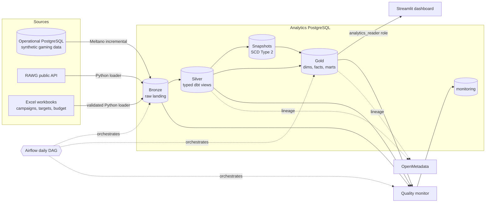
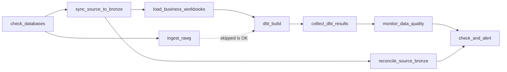

# Gaming Analytics Data Platform

An end-to-end, local data platform for ingesting, transforming, validating, governing, cataloguing and presenting gaming analytics data. It is a hands-on capstone implementation of a modern analytics workflow and of the DAMA-DMBOK knowledge areas, not a production deployment.

Three sources land in a PostgreSQL warehouse that follows the **medallion architecture**: **Bronze** keeps what arrived, **Silver** is typed and cleaned by dbt, **Gold** contains Kimball dimensions, facts and business marts. Airflow orchestrates the daily run, data-quality monitoring watches it, OpenMetadata catalogues it and a read-only Streamlit dashboard presents it.

## Contents

- [Architecture](#architecture)
- [Technology stack](#technology-stack)
- [Project structure](#project-structure)
- [Data model](#data-model)
- [Data governance (DAMA-DMBOK)](#data-governance-dama-dmbok)
- [Design decisions](#design-decisions)
- [Prerequisites and configuration](#prerequisites-and-configuration)
- [Quick start](#quick-start)
- [Workflows](#workflows)
- [Validation, testing and CI](#validation-testing-and-ci)
- [Demo script](#demo-script)
- [Operations](#operations)
- [Security and deployment notes](#security-and-deployment-notes)
- [Troubleshooting](#troubleshooting)

## Architecture



### Data zones

| Zone | Schema | Contents | Writer | Readable by BI |
| --- | --- | --- | --- | --- |
| Operational source | `public` in `postgres-source` | Synthetic transactional entities and events | Data generator | No |
| Bronze | `bronze` | Meltano streams, RAWG tables, Excel snapshots + Excel history | Meltano, Python loaders | No |
| Silver | `silver` | Typed dbt views (UTC `timestamptz`), soft-deleted rows removed, FX seed | dbt | No |
| Snapshots | `snapshots` | SCD Type 2 history of players and games | dbt snapshots | No |
| Gold | `gold` | Dimensions, facts, bridge table and business marts | dbt | **Yes** (`analytics_reader`) |
| Observability | `monitoring` | Quality runs, relation snapshots, dbt node results, Airflow task runs, alert log | Monitoring scripts, DAG callbacks | No |

### Airflow DAG



Other DAGs: `gaming_source_data_generator` (hourly synthetic traffic), `pipeline_watchdog` (10:00, independent alert check), `alert_drill` (manual, fails on purpose) and `dbt_weekly_full_refresh` (Sunday 04:00).

- `reconcile_source_bronze` compares row counts between the source database and Bronze (completeness across systems).
- `ingest_rawg` runs in parallel with Meltano. If the API key is missing or the API fails, the task is **skipped** (not failed) and `dbt_build` reuses the previously loaded RAWG data.
- `dbt_build` runs `dbt build`: seeds, snapshots, models, data tests, unit tests and contracts in dependency order. A failing test stops everything downstream of it, so bad data never reaches Gold.
- `collect_dbt_results`, `monitor_data_quality` and `check_and_alert` run even when an earlier task failed (`all_done`): the pipeline first measures, then judges. See [Operational monitoring and alerting](#6a-operational-monitoring-and-alerting).
- Every task in every DAG records its tries in `monitoring.task_runs`; a task that fails after its retries is emailed immediately.

## Technology stack

| Area | Technology | Purpose |
| --- | --- | --- |
| Containers | Docker Compose | Local services, networking, profiles, and persistent volumes |
| Operational store | PostgreSQL 17 | Synthetic gaming source database |
| Analytics warehouse | PostgreSQL 17 | Bronze, Silver, snapshots, Gold and monitoring schemas |
| Data generation | Python, Faker | Reproducible synthetic gaming data |
| Replication | Meltano, tap-postgres, target-postgres | Incremental source-to-Bronze replication |
| API ingestion | Python standard library, psycopg | Validated and retry-aware RAWG ingestion |
| Spreadsheet ingestion | openpyxl, psycopg | Excel contract validation, snapshot and history loading |
| Transformation | dbt Core 1.11, dbt-postgres | Silver views, SCD2 snapshots, incremental facts, marts, tests, contracts |
| Orchestration | Apache Airflow 3 (standalone, LocalExecutor, PostgreSQL metadata DB) | Scheduled pipelines, callbacks and alerts |
| Data quality | dbt tests, Python monitor | Rule-based tests plus freshness and volume monitoring |
| Metadata | OpenMetadata, MySQL, OpenSearch | Catalogue, descriptions, ownership and dbt lineage |
| Visualization | Streamlit, Altair, pandas | Read-only analytics dashboard |
| CI | GitHub Actions | Unit tests, `dbt parse`, Compose validation, end-to-end `dbt build` on PostgreSQL |

## Project structure

```text
.
├── .github/workflows/ci.yml              # CI: static checks + end-to-end dbt build
├── airflow/dags/
│   ├── gaming_analytics_pipeline.py      # Daily ingestion, dbt build, quality checks
│   ├── gaming_source_data_generator.py   # Hourly synthetic traffic into the source DB
│   ├── pipeline_watchdog.py              # Independent 10:00 watchdog + alert_drill
│   ├── dbt_weekly_full_refresh.py        # Sunday rebuild of incremental facts
│   └── pipeline_ops/                     # Shared env + task callbacks (in .airflowignore)
├── dashboard/app.py                      # Streamlit app (7 tabs incl. Pipeline health, read-only role)
├── data/business/                        # marketing_campaigns, game_targets, budget workbooks
├── dbt/
│   ├── macros/                           # UTC conversion, date keys, reader-role grants
│   ├── models/
│   │   ├── sources.yml                   # Bronze sources with owners and PII flags
│   │   ├── silver/                       # stg_* typed views
│   │   └── gold/                         # dim_*, fact_*, bridge, *_history
│   │       ├── marts/                    # mart_* business marts
│   │       └── ops/                      # ops_* pipeline health (from monitoring)
│   ├── seeds/fx_rates_to_usd.csv         # Illustrative FX reference data
│   ├── snapshots/snapshots.yml           # SCD Type 2 snapshots (players, games)
│   ├── tests/                            # Singular SQL tests
│   ├── dbt_project.yml
│   └── profiles.yml
├── docker/                               # Dockerfiles + analytics init script
├── ingestion/
│   ├── api/rawg.py                       # RAWG API client and loader
│   ├── excel/                            # Workbook generation and loading
│   └── generate/                         # generate_gaming_data CLI + behavior.py (churn, hits, campaigns)
├── metadata/
│   ├── ingest_postgres.py                # OpenMetadata PostgreSQL workflow
│   └── create_glossary.py                # Business glossary in OpenMetadata
├── meltano/meltano.yml
├── monitoring/
│   ├── data_quality.py                   # Freshness, volume and column-count checks
│   ├── collect_dbt_results.py            # dbt run_results.json -> monitoring.dbt_node_results
│   ├── task_events.py                    # Airflow task tries -> monitoring.task_runs
│   ├── reconcile.py                      # Source vs Bronze row counts
│   ├── checks.sql                        # The 14 alert rules
│   └── alerts.py                         # Rules -> one email + monitoring.alert_log
├── docs/deploy_vps.md                    # Step-by-step VPS deployment and end-to-end check
├── scripts/
│   ├── check_env.py                      # .env security audit
│   ├── generate_env.py                   # .env with fresh random secrets
│   └── vps_preflight.sh                  # Is this server ready? (RAM, Docker, ports, network)
├── sql/                                  # Source DDL, Bronze DDL, migrations, access roles
├── tests/                                # Python unit tests and CI fixtures
├── .env.example
└── docker-compose.yml
```

## Data model

### Silver (`silver`, views)

`stg_*` models cast every column to an explicit PostgreSQL type, exclude Meltano soft-deleted rows (`_sdc_deleted_at`) and convert all event timestamps to UTC `timestamptz` with the `to_utc_timestamptz` macro. `stg_rawg_game_genres` unpacks RAWG genres from the JSON payload and `stg_business_record_history` exposes the Excel audit trail.

### Gold core (`gold`, tables)

| Model | Grain | Notes |
| --- | --- | --- |
| `dim_date` | day | `date_key` (YYYYMMDD) from first activity to one year after today |
| `dim_players` | player | Current attributes. No username; birth year generalised to `age_band` |
| `dim_players_history` | player version | SCD Type 2 from `snap_players` (`valid_from`, `valid_to`, `is_current`) |
| `dim_games` | game | Current catalogue plus targets from `game_targets.xlsx` |
| `dim_games_history` | game version | SCD Type 2 of price and genre from `snap_games` |
| `dim_platforms` | platform | |
| `bridge_game_platforms` | game × platform | Many-to-many bridge |
| `fact_sessions` | session | **Incremental** (delete+insert on `session_id`, 3-day lookback on `updated_at`) |
| `fact_purchases` | purchase | **Incremental**; `amount` in original currency plus `amount_usd` |
| `fact_reviews` | review | |
| `fact_achievements` | achievement | |
| `fact_campaigns` | campaign | Budget calculations; campaigns without a budget row are kept and flagged by a test |

All facts carry `date_key` (joins to `dim_date.date_key`) and `date_day`. Day boundaries use the `reporting_timezone` dbt variable (default `UTC`).

### Gold marts (`gold`, tables)

| Mart | Business question |
| --- | --- |
| `mart_daily_kpis` | How many players were active, how many were new, and how much did they spend (DAU, ARPDAU, ARPPU in USD)? Contract-enforced. |
| `mart_game_target_vs_actual` | Which games meet their revenue, player, session and rating targets? |
| `mart_campaign_performance` | Did revenue of the promoted game rise during a campaign compared with the equally long period before it, relative to spend? |
| `mart_player_retention` | What share of each monthly cohort keeps playing N months later? |
| `mart_genre_benchmark` | How do our games' ratings compare with the external RAWG catalogue in the same genre? |

### Business glossary

| Term | Definition |
| --- | --- |
| DAU | Distinct players with at least one session on the day |
| New player | Player whose first ever session falls on the day |
| ARPDAU | Revenue (USD) of the day ÷ DAU |
| ARPPU | Revenue (USD) of the day ÷ paying players of the day |
| Retention rate | Active players of a cohort in month N ÷ cohort size |
| Revenue attainment | Actual revenue (USD) ÷ target revenue; 1.0 means the target is met |
| Revenue uplift | Campaign-window revenue − revenue of the equally long window just before |

The same definitions are stored as dbt descriptions and appear in OpenMetadata.

## Data governance (DAMA-DMBOK)

| DAMA knowledge area | How this project implements it |
| --- | --- |
| Data architecture | Medallion zones with one writer per zone; Kimball star schema in Gold |
| Data modelling | Declared grains, surrogate `date_key`, bridge table, SCD Type 2 history, contract on `mart_daily_kpis` |
| Data integration | Meltano incremental replication, validated API and Excel loaders, idempotent upserts |
| Data quality | dbt tests mapped to quality dimensions (below), freshness/volume/schema monitoring with history, source-to-Bronze reconciliation, 14 alert rules with once-per-day emails |
| Metadata management | Descriptions, owners, data stewards, classification and PII flags in dbt YAML; OpenMetadata catalogue and lineage; operational metadata (dbt results, task runs, alerts) kept as history in `monitoring` |
| Data security | Least-privilege roles; dashboard login reads Gold only, in read-only transactions |
| Reference and master data | `fx_rates_to_usd` seed; conformed `dim_games` / `dim_players` with history |
| Data warehousing and BI | Gold marts and the Streamlit dashboard |
| Document and content management | Excel workbooks with exact-schema contracts, file hashes and an append-only history |
| Data governance | Ownership (`meta.owner`, `meta.data_steward`) per source and model; documented decisions below |

### Data quality dimensions

| Dimension | Checks |
| --- | --- |
| Completeness | `not_null` tests; `amount_usd` not null (every currency has a rate); `actual_spend` not null |
| Uniqueness | `unique` on every primary key; `retention_grain_unique`; bridge pair uniqueness |
| Validity | `accepted_values` (payment method, rating, age band, file name); target ranges; retention rate between 0 and 1 |
| Consistency | `campaign_budget_matches`; `daily_kpis_reconcile_with_facts` (mart equals facts) |
| Integrity | `relationships` from every fact to its dimensions and to `dim_date`; session platform must be supported by the game |
| Timeliness | Freshness monitor on `_sdc_extracted_at`, `fetched_at` and `loaded_at` with warn/error thresholds |
| Accuracy (plausibility) | Session timestamps and duration rules; volume-change monitor |

### Personal data

| Column | Classification | Where it is available |
| --- | --- | --- |
| `username` | Direct identifier (PII) | Bronze and Silver only |
| `birth_year` | Quasi-identifier (PII) | Bronze and Silver; Gold exposes `age_band` only |
| `country` | Quasi-identifier | All layers |

Gold is the only schema granted to the `analytics_reader` role, so the dashboard cannot read PII even by mistake. This follows the data-minimisation principle of Mongolia's Law on the Protection of Personal Information (2021) and the GDPR.

### Data lifecycle

| Data | Retention policy (proposed) |
| --- | --- |
| Bronze Meltano tables | Kept while the source exists; rebuilt from the source if lost |
| `bronze.rawg_*.raw_payload` | Refreshed on each run; prune payloads older than 12 months if storage grows |
| `bronze.business_record_history` | Kept for 5 years for audit of targets and budgets |
| `monitoring.*` | Keep 13 months of runs for trend analysis |
| Gold | Rebuilt by dbt; snapshots keep the full attribute history |

## Design decisions

| Decision | Reason | Trade-off |
| --- | --- | --- |
| Meltano incremental replication instead of CDC (Debezium) | Simple, no Kafka; enough for a daily batch | Hard deletes and updates that do not advance `updated_at` are not seen |
| Event streams incremental, reference streams full-table | Events grow daily; dimensions are small | Full reloads of small tables cost little |
| No foreign keys in Bronze | Bronze must accept whatever arrives; a Bronze FK on a Meltano table can block reloads | Integrity is enforced by the loaders and dbt tests instead |
| Excel current snapshot + append-only history | Dashboards need "current"; auditors need "what was the target in March" | Extra storage, small for workbooks |
| RAWG compared by genre only | RAWG and the synthetic catalogue share no game key; genre is the conformed attribute | Benchmark is approximate; name matching would be error-prone |
| Original currency kept; USD via a seed | Never add amounts in different currencies | Seed rates are illustrative and static |
| Incremental facts with a 3-day lookback | Absorbs late-arriving updates while keeping runs fast | Rows deleted at source stay until `dbt build --full-refresh` |
| UTC storage, reporting time zone as a variable | Stable day boundaries regardless of server/session time zone | Change `reporting_timezone` to `Asia/Ulaanbaatar` for local-day reporting |
| Gold-only reader role | Least privilege and PII protection | New schemas must be granted deliberately |
| Alerts read only the `monitoring` history, each problem emailed once per day, ✅ when clean | Cheap enough to run several times a day; repeated alerts get muted, and a missing ✅ means the pipeline is dead | Needs one day of history before trend rules (slow task, warning grew) can fire |
| Targets compared with all warehouse activity | The workbook has no target period column | Add `target_year` to the workbook to compare per period |

## Prerequisites and configuration

- Docker Desktop with Docker Compose v2.
- Python 3.10 or newer (the containers and CI use Python 3.11).
- PowerShell on Windows.
- A RAWG API key for the RAWG workflow (optional; the DAG skips RAWG without it).
- SMTP settings only if email notifications are required.

```powershell
Copy-Item .env.example .env
```

Set a strong `POSTGRES_PASSWORD` and make `DATABASE_URL` match it. Do not commit `.env`.

| Variables | Required for | Notes |
| --- | --- | --- |
| `POSTGRES_USER`, `POSTGRES_PASSWORD`, `POSTGRES_DB`, `DATABASE_URL` | Databases, generator, loaders, dbt | `DATABASE_URL` targets the source database from the host |
| `ANALYTICS_DB`, `ANALYTICS_PORT` | Analytics loaders and dbt | Default host port `5433` |
| `DASHBOARD_DB_USER`, `DASHBOARD_DB_PASSWORD` | Dashboard | Read-only Gold login created by `sql/006_access_roles.sql` |
| `RAWG_API_KEY`, `RAWG_MAX_PAGES` | RAWG ingestion | Page count limits API usage |
| `AIRFLOW__SMTP__*`, `QUALITY_ALERT_EMAIL_TO`, `QUALITY_EMAIL_ENABLED` | Alert emails | Without them alerts are only logged in `monitoring.alert_log` |
| `ALERT_NAME`, `ALERT_TIMEZONE` | Alert emails | Name in the subject line; business day for "once per day" (default `Asia/Ulaanbaatar`) |
| `OPENMETADATA_MYSQL_ROOT_PASSWORD`, `OPENMETADATA_JWT_TOKEN` | OpenMetadata | Only for the `openmetadata` profile |
| `DATA_QUALITY_*` | Quality monitor | Optional threshold overrides |

```powershell
docker compose config --quiet
```

## Quick start

Deploying to a server (VPS)? Follow [docs/deploy_vps.md](docs/deploy_vps.md): preflight check, generated secrets, and a verified run of every DAG.

```powershell
# 1. Start the source and analytics databases.
docker compose up -d --wait postgres-source postgres-analytics

# 2. Python environment.
py -3 -m venv .venv
.\.venv\Scripts\python.exe -m pip install -r requirements.txt

# 3. Seed the source database.
.\.venv\Scripts\python.exe -m ingestion.generate.generate_gaming_data

# 4. Replicate the source into Bronze.
docker compose build meltano
docker compose run --rm meltano install
docker compose run --rm meltano run tap-postgres target-postgres

# 5. Load the business workbooks (needs bronze.games from step 4).
.\.venv\Scripts\python.exe -m ingestion.excel.load_excel

# 6. Create the read-only dashboard login (once per analytics database).
$localEnv = Get-Content .env -Raw | ConvertFrom-StringData
docker compose exec -T postgres-analytics psql -U $localEnv.POSTGRES_USER -d $localEnv.ANALYTICS_DB `
    -v dashboard_password=$($localEnv.DASHBOARD_DB_PASSWORD) -f /sql/006_access_roles.sql

# 7. Build and test everything with dbt.
$env:POSTGRES_USER = $localEnv.POSTGRES_USER
$env:POSTGRES_PASSWORD = $localEnv.POSTGRES_PASSWORD
$env:ANALYTICS_DB = $localEnv.ANALYTICS_DB
$env:ANALYTICS_PORT = $localEnv.ANALYTICS_PORT
$env:DBT_HOST = "localhost"
.\.venv\Scripts\dbt.exe build --project-dir dbt --profiles-dir dbt
```

On a brand-new analytics volume step 6 runs automatically (`docker/postgres-analytics/10-access-roles.sh`) when `DASHBOARD_DB_PASSWORD` is set.

> **Upgrading an existing database** (created before the Bronze/Silver/Gold rename or before this version):
> 1. Run `sql/005_rename_analytics_layers.sql` once if the old `raw`/`staging`/`staging_core` schemas exist.
> 2. Run the Excel loader once; it applies `sql/004_excel_business_schema.sql`, which drops the old Bronze foreign keys and creates the history tables.
> 3. Run `dbt build --full-refresh` once, because `fact_sessions` and `fact_purchases` changed from tables to incremental models.
> 4. Optional, for the behaviour model: re-seed the source (`--reset`) and refresh targets (`generate_business_data --only targets`), then run Meltano and `dbt build --full-refresh`.

## Workflows

### 1. Synthetic source data

One CLI, `ingestion.generate.generate_gaming_data`, creates deterministic, referentially valid operational data in `postgres-source.public`. Both modes use the same row builders and behaviour model, so the business rules (activity never before account creation or game release, sessions only on supported platforms, one review per player and game) are identical.

Uniformly random data gives flat dashboards, so `ingestion/generate/behavior.py` adds the patterns real gaming data has. Traits are derived from the entity id, so the initial load and every hourly append agree on them.

| Pattern | Effect in the marts |
| --- | --- |
| Players have an activity level and a lifetime (55 % casual ≈ 1 month, 30 % regular ≈ 5 months, 15 % loyal for years) | Retention decays month by month |
| 70 % never pay, 25 % pay sometimes, 5 % are "whales" | Realistic payer share and ARPPU |
| Game popularity is heavy-tailed; each game has a hidden quality | A few hits dominate; ratings differ by game |
| Sessions follow the Ulaanbaatar day (night ≈ 0.2x, evening peak), weekends +20 % | Daily and weekly rhythm in DAU |
| Campaigns in `marketing_campaigns.xlsx` make the promoted game ≈ 2.5x as popular while they run | Positive campaign uplift |
| Purchases happen inside sessions, in the player's local currency (MN → MNT, JP → JPY, ...) | Multi-currency revenue; USD via the FX seed |
| Reviews and achievements only from player/game pairs that played | Consistent funnels |

| Mode | What it does | Defaults |
| --- | --- | --- |
| `--mode initial` (default) | Builds a complete dataset; refuses to write into populated tables unless `--reset` | seed 42, as-of 2025-12-31, 10 000 players, 1 000 games, 100 000 sessions |
| `--mode append` | Adds new players, games and activity on top of existing data; never deletes or updates; IDs continue from `MAX(id) + 1` | seed 123, as-of today, 1 000 players, 100 games, 10 000 sessions |

```powershell
# Initial dataset
.\.venv\Scripts\python.exe -m ingestion.generate.generate_gaming_data
# Small dataset for fast local tests
.\.venv\Scripts\python.exe -m ingestion.generate.generate_gaming_data --players 100 --games 20 --sessions 500 --purchases 100 --reviews 100
# Destructive: replace all generated source rows
.\.venv\Scripts\python.exe -m ingestion.generate.generate_gaming_data --reset
# Append a daily-sized batch (any count can be 0)
.\.venv\Scripts\python.exe -m ingestion.generate.generate_gaming_data --mode append --sessions 2000 --purchases 500
# One hour of events (what the hourly DAG runs); all timestamps fall inside the window
.\.venv\Scripts\python.exe -m ingestion.generate.generate_gaming_data --mode append `
    --window-start 2026-10-31T09:00:00+08:00 --window-end 2026-10-31T10:00:00+08:00 `
    --players 40 --games 0 --sessions 400 --purchases 120 --reviews 80 --achievements 80
# All options and per-mode defaults
.\.venv\Scripts\python.exe -m ingestion.generate.generate_gaming_data --help
```

**Re-seeding** with the behaviour model: keep the campaigns (they shape the activity), then refresh the targets from the new actuals.

```powershell
.\.venv\Scripts\python.exe -m ingestion.generate.generate_gaming_data --reset
.\.venv\Scripts\python.exe -m ingestion.excel.generate_business_data --only targets
```

The committed `game_targets.xlsx` already matches a default `--reset` seed.

### 2. Incremental source-to-Bronze replication

Meltano reads the source `public` schema with `tap-postgres` and `target-postgres` upserts into `bronze` by primary key, keeping Singer `_sdc_*` metadata.

- `sessions`, `purchases`, `reviews` and `achievements` replicate **incrementally** on `updated_at`.
- `players`, `games`, `platforms` and `game_platforms` are small and reload in full.

```powershell
docker compose run --rm meltano install
docker compose run --rm meltano run tap-postgres target-postgres
```

This is incremental replication, not change-data capture: hard deletes and updates that do not advance `updated_at` are not detected.

### 3. RAWG API ingestion

Ingests a bounded external catalogue of games, platforms, genres, publishers and developers into `bronze.rawg_*`. The loader validates responses, checks pagination URLs, retries transient failures and rate limits, stores the original payload as JSONB and upserts by RAWG ID. dbt uses it for `mart_genre_benchmark`.

```powershell
.\.venv\Scripts\python.exe -m ingestion.api.rawg --help
.\.venv\Scripts\python.exe -m ingestion.api.rawg --resources games --page-size 40 --max-pages 2
.\.venv\Scripts\python.exe -m ingestion.api.rawg --resources platforms genres publishers developers --max-pages 3
```

Set `RAWG_API_KEY` in `.env` first. Show the RAWG attribution wherever RAWG-derived data is displayed (the dashboard does this on the benchmark tab).

### 4. Excel business data

Workbooks in `data/business`: `marketing_campaigns.xlsx`, `game_targets.xlsx`, `budget.xlsx`.

`generate_business_data` sets each target to the game's actual revenue (USD), players, sessions and rating times a random ambition factor (0.7-1.4), so roughly a third to half of the games meet their target.

The loader requires exact sheet names and headers, normalises types, rejects invalid dates and values, checks campaign/budget agreement, confirms referenced games exist in `bronze.games`, deduplicates identical rows and skips unchanged files by SHA-256. Each changed load:

- replaces the current snapshot tables (`bronze.raw_*`), and
- appends to `bronze.business_load_log` (one row per file) and `bronze.business_record_history` (every record as JSON), so earlier targets and budgets remain auditable.

```powershell
.\.venv\Scripts\python.exe -m ingestion.excel.generate_business_data   # all three sample workbooks
.\.venv\Scripts\python.exe -m ingestion.excel.generate_business_data --only targets  # targets from actuals
.\.venv\Scripts\python.exe -m ingestion.excel.load_excel
.\.venv\Scripts\python.exe -m ingestion.excel.load_excel --force       # reload unchanged files
```

### 5. dbt build

```powershell
$localEnv = Get-Content .env -Raw | ConvertFrom-StringData
$env:POSTGRES_USER = $localEnv.POSTGRES_USER
$env:POSTGRES_PASSWORD = $localEnv.POSTGRES_PASSWORD
$env:ANALYTICS_DB = $localEnv.ANALYTICS_DB
$env:ANALYTICS_PORT = $localEnv.ANALYTICS_PORT
$env:DBT_HOST = "localhost"

.\.venv\Scripts\dbt.exe debug --project-dir dbt --profiles-dir dbt
.\.venv\Scripts\dbt.exe build --project-dir dbt --profiles-dir dbt                 # everything
.\.venv\Scripts\dbt.exe build --project-dir dbt --profiles-dir dbt --full-refresh  # rebuild incremental facts
.\.venv\Scripts\dbt.exe build --project-dir dbt --profiles-dir dbt --select +mart_daily_kpis
.\.venv\Scripts\dbt.exe docs generate --project-dir dbt --profiles-dir dbt
```

`dbt build` runs, in dependency order: the FX seed, Silver views, snapshots, Gold dimensions and facts, marts, all data tests, the unit test on `fact_campaigns` and the contract on `mart_daily_kpis`. Run hooks create the `analytics_reader` group role if needed and grant it Gold.

### 6. Data-quality monitoring

Detects empty relations, stale ingestion and large row-count changes across Bronze, Silver, snapshots and Gold. Results are stored in the `monitoring` schema; the first run sets the volume baseline. RAWG relations are *optional*: when RAWG has not been loaded (no API key), their empty or stale state is reported as a warning, not a failure, so the DAG stays green.

```powershell
.\.venv\Scripts\python.exe -m monitoring.data_quality
```

Thresholds: `DATA_QUALITY_VOLUME_CHANGE_WARN_PERCENT`, `DATA_QUALITY_FRESHNESS_WARN_HOURS`, `DATA_QUALITY_FRESHNESS_ERROR_HOURS` and the Excel freshness variables.

### 6a. Operational monitoring and alerting

The warehouse tables describe the business; the `monitoring` schema describes the **pipeline**. Airflow, dbt and PostgreSQL only know the current state, so every run is stored as history. That history is what makes "the warning grew from 71 to 140" or "this task is 3x slower than usual" visible at all.

| Table | Written by | One row per |
| --- | --- | --- |
| `monitoring.data_quality_runs`, `data_quality_snapshots` | `monitoring.data_quality` | check run / relation (rows, columns, freshness, volume) |
| `monitoring.dbt_node_results` | `monitoring.collect_dbt_results` (after `dbt_build`) | dbt node per invocation (status, seconds, failures) |
| `monitoring.task_runs` | Airflow callbacks (`airflow/dags/pipeline_ops`) | task try (state, duration) |
| `monitoring.reconciliation` | `monitoring.reconcile` | table per check (source rows, Bronze rows, status) |
| `monitoring.alert_log` | `monitoring.alerts` | alert that fired (sent or not) |

`monitoring/checks.sql` holds the rules. Each returns `severity, check_name, object, detail`; zero rows means all is well.

| # | Rule | Severity | Fires when |
| --- | --- | --- | --- |
| 1 | `stale_source` | critical / warn | Freshness of a Bronze source failed / warned (never-loaded optional RAWG is ignored) |
| 2 | `empty_relation` | critical | A required relation has 0 rows |
| 3 | `volume_jump` | warn | Row count changed more than the volume threshold |
| 4 | `rows_disappeared` | critical | An append-only table (events, accounts, facts, snapshots) shrank |
| 5 | `schema_changed` | warn | A relation gained or lost columns |
| 6 | `dbt_failed` | critical | A dbt model, snapshot, seed or test errored or failed |
| 7 | `dbt_skipped` | warn | dbt skipped nodes because something upstream failed |
| 8 | `warning_grew` | warn | A dbt test warning is new or has more failing rows than last time |
| 9 | `task_failed` | critical | An Airflow task failed today after its retries |
| 10 | `slow_task` | warn | A task took over 60 s and 3x its 7-day average |
| 11 | `pipeline_silent` | critical | No quality check ran today: silence must not look like health |
| 12 | `generator_silent` | warn | The hourly generator has not succeeded for 3 hours |
| 13 | `source_bronze_mismatch` | critical | Source rows (up to Bronze's newest `updated_at`) are missing in Bronze, or Bronze is empty |
| 14 | `deleted_at_source` | warn | Bronze keeps rows the source deleted (hard deletes are not replicated) |

**Reconciliation.** For each replicated table, with `bound` = the newest `updated_at` in Bronze: every source row with `updated_at <= bound` must be in Bronze, and Bronze cannot have more rows than the source (for append-only event tables, exactly as many). Rows created after the last Meltano sync are therefore not reported as missing.

**Weekly full refresh.** `dbt_weekly_full_refresh` (created paused: unpause it after the first successful daily run) runs `dbt build --full-refresh` every Sunday at 04:00, so incremental facts drop rows deleted upstream and pick up updates older than the 3-day lookback. Snapshots keep their history.

**Pipeline health in the dashboard.** `gold.ops_quality_daily`, `ops_relation_health`, `ops_dbt_results_daily`, `ops_task_daily` and `ops_alerts` expose the monitoring history to the read-only role (values up to the previous pipeline run). On a new database they are empty instead of failing the build.

`monitoring.alerts` turns rows into **one email** per run (grouped by rule, at most five examples each), sends each problem **once per day**, sends a short **✅ "all checks passed"** when nothing fired, and exits with code 1 on a critical problem so `check_and_alert` turns red.

Two small extra DAGs (`airflow/dags/pipeline_watchdog.py`):

- `pipeline_watchdog` runs the same rules at 10:00 on its own schedule, so a pipeline that died before its own `check_and_alert` is still reported (`pipeline_silent`). It stays quiet when all is fine.
- `alert_drill` is never scheduled: trigger it by hand once. It fails on purpose; a `task_failed` email proves the alert chain works before a real failure does.

```powershell
.\.venv\Scripts\python.exe -m monitoring.alerts --dry-run      # what would be sent; sends and logs nothing
docker compose exec airflow airflow dags trigger alert_drill    # expect a "task failed" email
```

Both watcher DAGs live in the same Airflow: if the scheduler itself is down, nothing runs. A heartbeat from outside (a cron job or uptime service checking `monitoring.data_quality_runs`) is the honest answer to "who watches the watcher".

### 7. Airflow orchestration

The DAG runs daily at `02:00` `Asia/Ulaanbaatar`, with `catchup=False`, one active run and one retry per task. Airflow runs in `standalone` mode with the LocalExecutor. Its metadata database is a dedicated PostgreSQL service (`postgres-airflow`, internal only), because SQLite serialises every write and breaks down once several DAGs run at the same time. Set `AIRFLOW_DB_PASSWORD` (URL-safe characters) in `.env` first.

> Moving from the old SQLite metadata starts with a fresh Airflow history (DAG runs, logs, the admin password). Pipeline data and the `monitoring` history are not affected.

```powershell
docker compose --profile orchestration up -d --build --wait airflow
docker compose exec airflow airflow dags list-import-errors
docker compose exec airflow airflow tasks list gaming_analytics_pipeline
docker compose exec airflow airflow dags trigger gaming_analytics_pipeline
docker compose exec airflow cat /opt/airflow/simple_auth_manager_passwords.json.generated   # Airflow 3: {"admin": "..."}
```

The UI is at `http://localhost:8080`; the last command prints the admin password that Airflow 3's simple auth manager generated on first start (if the file is missing: `docker compose logs airflow | grep -i password`).

### 7a. Hourly source traffic (`gaming_source_data_generator`)

A second DAG simulates live traffic by appending **one hour of activity** to the source database every hour (`0 * * * *`, `catchup=False`, one active run).

| Setting | Value | Why |
| --- | --- | --- |
| Generator call | `--mode append --window-start <data_interval_start> --window-end <data_interval_end>` | Every new account, game and event is timestamped inside that hour, so `updated_at` is newer than Meltano's bookmark and the daily 02:00 sync picks it up |
| Seed | CRC32 of the window | A retry of the same hour regenerates the same batch; the generator writes in one transaction, so a failed attempt leaves nothing |
| Base volume per average hour | 40 players, 400 sessions, 120 purchases, 80 reviews, 80 achievements | A weekday totals 24 x base (≈ 9 600 sessions), matching the daily append defaults |
| Traffic curve | Asia/Ulaanbaatar hours: night ≈ 0.2x, evening peak ≈ 2x; weekends +20 % | Realistic DAU and retention patterns in the marts |
| New games | one every 24 hours (`new_game_every_hours`) plus `games` extra per run | New releases are rare |
| Retries | 2, 2 minutes apart; 20-minute timeout | Transient database errors |

All values are DAG params: change them for one run with **Trigger DAG w/ config** in the Airflow UI, or set `seasonality` to `false` for a flat rate. The source must be seeded once with `--mode initial` first; otherwise the task fails with that hint.

```powershell
docker compose exec airflow airflow dags trigger gaming_source_data_generator
docker compose exec airflow airflow dags trigger gaming_source_data_generator --conf '{"sessions": 2000, "seasonality": false}'   # PowerShell 7+
docker compose exec airflow airflow dags pause gaming_source_data_generator   # stop generating
```

### 8. Dashboard

```powershell
docker compose --profile dashboard up -d --build --wait dashboard
```

Open `http://localhost:8501`. The app connects as `dashboard_user` (Gold only, read-only transactions, 30 s statement timeout) and has seven tabs: **Overview**, **Daily KPIs**, **Targets vs actual**, **Campaigns**, **Retention**, **Genre benchmark (RAWG)** and **Pipeline health** (quality trend, dbt test results, task durations, recent alerts). Purchase values in different currencies are never added together; USD figures use the FX reference seed.

### 9. Metadata and lineage (optional)

```powershell
docker compose --profile openmetadata up -d --wait openmetadata-server
Invoke-RestMethod http://localhost:8585/healthcheck
docker compose --profile openmetadata run --rm openmetadata-ingestion
# Business glossary first, so dbt can link models to its terms
docker compose --profile openmetadata run --rm --entrypoint python openmetadata-ingestion /opt/metadata/create_glossary.py
.\.venv\Scripts\dbt.exe docs generate --project-dir dbt --profiles-dir dbt
docker compose --profile openmetadata run --rm --entrypoint metadata openmetadata-ingestion ingest-dbt -c /project/dbt
```

What appears in OpenMetadata at `http://localhost:8585`:

| dbt metadata | In OpenMetadata |
| --- | --- |
| `description` on models and columns | Asset and column descriptions (`openmetadata_dbt_update_descriptions: true`) |
| `tags` (`pii` on username / birth_year / country, `silver`, `gold`, `mart`, `ops`) | Tags in the `DataGovernance` classification |
| `meta.openmetadata.tier` (marts Tier1, core Tier2, ops Tier3) | Tier of each table |
| `meta.openmetadata.glossary` (e.g. `mart_daily_kpis` → DAU, ARPDAU, ARPPU) | Glossary terms linked to the tables that implement them |
| `meta.owner`, `meta.data_steward`, `meta.classification` | Custom properties on the asset |

The `GamingAnalytics` glossary (10 terms) is created by `metadata/create_glossary.py`, idempotently. Stop the stack when not in use; it is memory-intensive.

## Validation, testing and CI

Local checks:

```powershell
.\.venv\Scripts\python.exe -m compileall -q ingestion monitoring dashboard tests airflow scripts metadata
.\.venv\Scripts\python.exe -m unittest discover -s tests -v
docker compose config --quiet
```

`dbt parse` without a database:

```powershell
$env:DBT_HOST = "localhost"; $env:ANALYTICS_PORT = "5433"
$env:POSTGRES_USER = "gaming"; $env:POSTGRES_PASSWORD = "ci-only-placeholder"
$env:ANALYTICS_DB = "gaming_analytics"
$env:OPENMETADATA_HOST_PORT = "http://localhost:8585/api"
$env:OPENMETADATA_JWT_TOKEN = "ci-only-placeholder"
$env:OPENMETADATA_SERVICE_NAME = "gaming-analytics-ci"
.\.venv\Scripts\dbt.exe parse --no-partial-parse --project-dir dbt --profiles-dir dbt
```

GitHub Actions (`.github/workflows/ci.yml`) runs two jobs on every push and pull request:

1. **static-checks**: byte-compilation, Python unit tests, `dbt parse`, `docker compose config` for every profile.
2. **dbt-integration**: starts PostgreSQL, generates synthetic data, emulates the Meltano sync (`tests/fixtures/ci_bronze_from_source.sql`), loads generated workbooks, creates the access roles, runs `dbt build` twice (second run exercises the incremental and snapshot paths) and verifies that `dashboard_user` can read Gold but not Silver.

## Demo script

A 5-minute demonstration of incremental processing and history:

```powershell
# 1. Baseline
docker compose exec airflow airflow dags trigger gaming_analytics_pipeline

# 2. New activity and an attribute change in the source
.\.venv\Scripts\python.exe -m ingestion.generate.generate_gaming_data --mode append --players 50 --sessions 2000 --purchases 300
docker compose exec -T postgres-source psql -U gaming -d gaming_source -c "UPDATE games SET price = 4.99, updated_at = now() WHERE game_id = 1"

# 3. Run again: Meltano reads only new rows, dbt merges them into the incremental facts,
#    and the snapshot records the new game price.
docker compose exec airflow airflow dags trigger gaming_analytics_pipeline
docker compose exec -T postgres-analytics psql -U gaming -d gaming_analytics -c "SELECT game_id, price, valid_from, valid_to, is_current FROM gold.dim_games_history WHERE game_id = 1 ORDER BY valid_from"

# 4. Show the dashboard (Daily KPIs, Targets, Campaigns, Retention, Genre benchmark)
#    and the lineage of mart_daily_kpis in OpenMetadata.
```

## Operations

```powershell
docker compose ps
docker compose logs --tail 100 postgres-source postgres-analytics
docker compose --profile orchestration logs --tail 100 airflow
docker compose --profile dashboard logs --tail 100 dashboard
```

Stop services while preserving data:

```powershell
docker compose --profile orchestration stop airflow
docker compose --profile dashboard stop dashboard
docker compose --profile openmetadata stop openmetadata-server openmetadata-mysql openmetadata-opensearch
docker compose stop postgres-source postgres-analytics
```

Named Docker volumes preserve database, Airflow, Meltano and OpenMetadata state. Do not run `docker compose down --volumes` unless deleting all local data is intentional.

## Security and deployment notes

- Secrets live only in the ignored `.env` file. Run `python -m scripts.check_env` before starting the stack: it reports placeholders, mismatched or reused passwords, short secrets and non-URL-safe characters, without printing any value.
- PostgreSQL, Airflow, Streamlit and OpenMetadata ports bind to `127.0.0.1`.
- The dashboard uses a dedicated `dashboard_user` login that can only `SELECT` from Gold, with `default_transaction_read_only` and a statement timeout; it runs as a non-root user without Linux capabilities.
- Bronze, Silver, snapshots and monitoring are not granted to any BI role; PII stays there.
- This is not a production deployment: there is no HA, no remote secret manager, no TLS termination and no tested disaster-recovery process. The OpenMetadata/OpenSearch configuration is for isolated local learning only.
- Database init scripts run only for a new volume. Apply changes to existing databases deliberately (see *Upgrading an existing database*).

### Secrets checklist

| Variable | Used by | How to set it |
| --- | --- | --- |
| `POSTGRES_PASSWORD` (+ the same value inside `DATABASE_URL`) | Source and analytics databases, loaders, dbt | `python -c "import secrets; print(secrets.token_urlsafe(24))"` |
| `DASHBOARD_DB_PASSWORD` | Read-only `dashboard_user` | Its own value, never the owner password |
| `AIRFLOW_DB_PASSWORD` | Airflow metadata DB | URL-safe characters only (it is part of a connection URL) |
| `AIRFLOW__API_AUTH__JWT_SECRET` | Airflow API | At least 32 random characters |
| `AIRFLOW__SMTP__SMTP_PASSWORD` | Alert emails | Gmail: a 16-character App Password with 2-Step Verification on |
| `OPENMETADATA_MYSQL_ROOT_PASSWORD` | OpenMetadata MySQL | Random; set before the first `openmetadata` start |
| `OPENMETADATA_DB_USER` / `OPENMETADATA_DB_PASSWORD` | OpenMetadata server | Defaults match the image; change only after `ALTER USER` in MySQL |
| `OPENMETADATA_JWT_TOKEN`, `RAWG_API_KEY` | Metadata ingestion, RAWG | From the OpenMetadata UI (ingestion-bot) / rawg.io |

## Troubleshooting

| Symptom | Recommended check |
| --- | --- |
| Anything fails to connect after editing `.env` | `python -m scripts.check_env` |
| `postgres-airflow` does not start | `AIRFLOW_DB_PASSWORD` is empty in `.env` |
| Docker service does not start | `docker compose ps` and `docker compose logs <service>`; confirm Docker Desktop is running |
| Python loader cannot connect | Both PostgreSQL services healthy; `.env` settings match the host ports |
| Meltano plugin or state issues | Rebuild the image, `docker compose run --rm meltano install`, rerun |
| RAWG task is *skipped* in Airflow | Expected without `RAWG_API_KEY` or when the API fails; check the task log |
| Excel loader rejects game IDs | Every `game_id` in the workbooks must exist in `bronze.games` |
| `dbt build` fails on `fact_sessions` after upgrading | Run `dbt build --full-refresh` once |
| `relationships` test fails on `currency` | Add the new currency to `dbt/seeds/fx_rates_to_usd.csv` |
| Dashboard: "Set DASHBOARD_DB_PASSWORD" | Add it to `.env` and run `sql/006_access_roles.sql` (Quick start step 6) |
| Dashboard: permission denied for schema gold | Run `dbt build` (it grants Gold to `analytics_reader`) |
| No alert emails arrive | Set the `AIRFLOW__SMTP__*` variables and `QUALITY_ALERT_EMAIL_TO`, then trigger `alert_drill`; until then alerts are only in `monitoring.alert_log` |
| `check_and_alert` is red | A critical rule fired: read the email or `SELECT * FROM monitoring.alert_log ORDER BY alert_id DESC` |
| Airflow DAG is missing | `docker compose exec airflow airflow dags list-import-errors`; rebuild after dependency changes |

## License and intended use

Educational capstone project. Source gaming records are synthetic and the RAWG collection is bounded for demonstration. Follow RAWG's terms and attribution requirements when using API-derived data.
