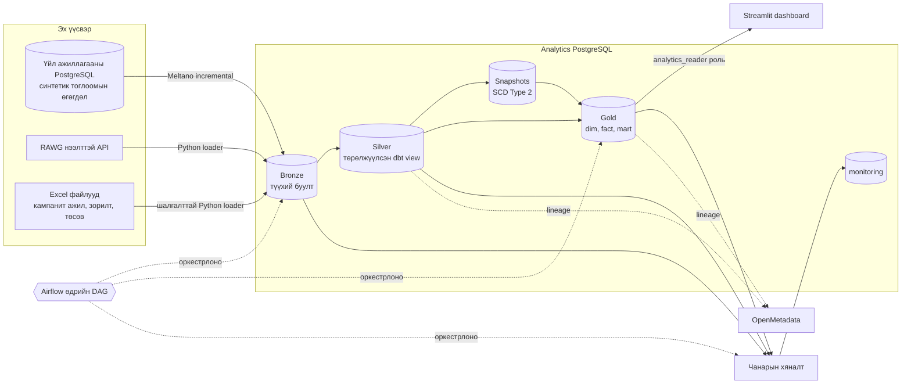
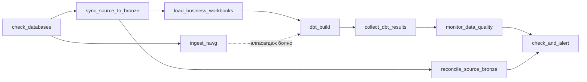

# Gaming Analytics Data Platform

> Монгол орчуулга. Эх хувилбар: [README.md](../README.md) (англи). Код, команд, хүснэгт/баганын нэр орчуулагдаагүй.

Тоглоомын аналитикийн өгөгдлийг татах, хувиргах, шалгах, засаглах, каталогжуулах, харуулах бүх шатыг хамарсан, локал орчинд ажилладаг өгөгдлийн платформ. Энэ нь орчин үеийн аналитикийн ажлын урсгал болон DAMA-DMBOK-ийн мэдлэгийн салбаруудыг практикт хэрэгжүүлсэн төгсөлтийн (capstone) төсөл бөгөөд production орчинд зориулагдаагүй.

Гурван эх үүсвэрийн өгөгдөл **medallion архитектур**-тай PostgreSQL агуулахад ирнэ: **Bronze** ирсэн өгөгдлийг тэр чигээр нь хадгална, **Silver**-ийг dbt төрөлжүүлж цэвэрлэнэ, **Gold** нь Kimball загварын dimension, fact болон бизнесийн mart-уудыг агуулна. Airflow өдөр бүрийн ажиллагааг оркестрлож, өгөгдлийн чанарын хяналт түүнийг ажиглаж, OpenMetadata каталогжуулж, зөвхөн уншдаг Streamlit dashboard харуулна.

## Агуулга

- [Архитектур](#архитектур)
- [Технологийн стек](#технологийн-стек)
- [Төслийн бүтэц](#төслийн-бүтэц)
- [Өгөгдлийн загвар](#өгөгдлийн-загвар)
- [Өгөгдлийн засаглал (DAMA-DMBOK)](#өгөгдлийн-засаглал-dama-dmbok)
- [Дизайны шийдвэрүүд](#дизайны-шийдвэрүүд)
- [Шаардлага ба тохиргоо](#шаардлага-ба-тохиргоо)
- [Хурдан эхлэх](#хурдан-эхлэх)
- [Ажлын урсгалууд](#ажлын-урсгалууд)
- [Баталгаажуулалт, тест ба CI](#баталгаажуулалт-тест-ба-ci)
- [Demo скрипт](#demo-скрипт)
- [Ашиглалт](#ашиглалт)
- [Аюулгүй байдал ба байршуулалтын тэмдэглэл](#аюулгүй-байдал-ба-байршуулалтын-тэмдэглэл)
- [Асуудал шийдвэрлэх](#асуудал-шийдвэрлэх)

## Архитектур



### Өгөгдлийн бүсүүд

| Бүс | Schema | Агуулга | Бичигч | BI уншиж чадах эсэх |
| --- | --- | --- | --- | --- |
| Үйл ажиллагааны эх үүсвэр | `postgres-source` дахь `public` | Синтетик гүйлгээний объект ба event-үүд | Өгөгдөл үүсгэгч | Үгүй |
| Bronze | `bronze` | Meltano stream, RAWG хүснэгт, Excel snapshot + Excel-ийн түүх | Meltano, Python loader | Үгүй |
| Silver | `silver` | Төрөлжүүлсэн dbt view (UTC `timestamptz`), soft-delete хийсэн мөр хасагдсан, FX seed | dbt | Үгүй |
| Snapshots | `snapshots` | Тоглогч, тоглоомын SCD Type 2 түүх | dbt snapshot | Үгүй |
| Gold | `gold` | Dimension, fact, bridge хүснэгт, бизнесийн mart | dbt | **Тийм** (`analytics_reader`) |
| Ажиглалт (observability) | `monitoring` | Чанарын шалгалт, relation snapshot, dbt node-ийн үр дүн, Airflow task run, alert log | Хяналтын скриптүүд, DAG callback | Үгүй |

### Airflow DAG



Бусад DAG: `gaming_source_data_generator` (цаг тутмын синтетик ачаалал), `pipeline_watchdog` (10:00, бие даасан alert шалгалт), `alert_drill` (гараар ажиллуулна, зориуд унадаг), `dbt_weekly_full_refresh` (ням гараг 04:00).

- `reconcile_source_bronze` нь эх үүсвэрийн database болон Bronze-ийн мөрийн тоог харьцуулна (системүүдийн хоорондох бүрэн бүтэн байдал).
- `ingest_rawg` нь Meltano-тэй зэрэг ажиллана. API key байхгүй эсвэл API алдаа өгвөл task **алгасагдана** (унахгүй), `dbt_build` өмнө ачаалсан RAWG өгөгдлийг ашиглана.
- `dbt_build` нь `dbt build`-ийг ажиллуулна: seed, snapshot, model, өгөгдлийн тест, unit test, contract-ыг хамаарлын дарааллаар. Тест унавал түүнээс доош бүх зүйл зогсох тул муу өгөгдөл Gold-д хэзээ ч хүрэхгүй.
- `collect_dbt_results`, `monitor_data_quality`, `check_and_alert` нь өмнөх task унасан ч ажиллана (`all_done`): pipeline эхлээд хэмжиж, дараа нь дүгнэнэ. [Үйл ажиллагааны хяналт ба alert](#6a-үйл-ажиллагааны-хяналт-ба-alert)-ийг үзнэ үү.
- Бүх DAG-ийн бүх task оролдлого бүрээ `monitoring.task_runs`-д бичнэ. Retry-уудын дараа унасан task-ийн тухай имэйл шууд илгээгдэнэ.

## Технологийн стек

| Чиглэл | Технологи | Зорилго |
| --- | --- | --- |
| Контейнер | Docker Compose | Локал үйлчилгээ, сүлжээ, profile, байнгын volume |
| Үйл ажиллагааны сан | PostgreSQL 17 | Синтетик тоглоомын эх үүсвэрийн database |
| Аналитикийн агуулах | PostgreSQL 17 | Bronze, Silver, snapshots, Gold болон monitoring schema |
| Өгөгдөл үүсгэх | Python, Faker | Давтан гаргах боломжтой синтетик тоглоомын өгөгдөл |
| Репликаци | Meltano, tap-postgres, target-postgres | Эх үүсвэрээс Bronze руу incremental репликаци |
| API-аас татах | Python standard library, psycopg | Шалгалттай, retry хийдэг RAWG ingestion |
| Хүснэгтэн файлаас татах | openpyxl, psycopg | Excel-ийн гэрээ (contract) шалгах, snapshot ба түүх ачаалах |
| Хувиргалт | dbt Core 1.11, dbt-postgres | Silver view, SCD2 snapshot, incremental fact, mart, тест, contract |
| Оркестр | Apache Airflow 3 (standalone, LocalExecutor, PostgreSQL metadata DB) | Хуваарьт pipeline, callback, alert |
| Өгөгдлийн чанар | dbt тест, Python монитор | Дүрэмд суурилсан тест, шинэлэг байдал ба хэмжээний хяналт |
| Metadata | OpenMetadata, MySQL, OpenSearch | Каталог, тайлбар, эзэмшигч, dbt lineage |
| Дүрслэл | Streamlit, Altair, pandas | Зөвхөн уншдаг аналитикийн dashboard |
| CI | GitHub Actions | Unit test, `dbt parse`, Compose шалгалт, PostgreSQL дээр бүрэн `dbt build` |

## Төслийн бүтэц

```text
.
├── .github/workflows/ci.yml              # CI: статик шалгалт + бүрэн dbt build
├── airflow/dags/
│   ├── gaming_analytics_pipeline.py      # Өдөр бүрийн ingestion, dbt build, чанарын шалгалт
│   ├── gaming_source_data_generator.py   # Эх үүсвэр рүү цаг тутмын синтетик ачаалал
│   ├── pipeline_watchdog.py              # Бие даасан 10:00-ийн watchdog + alert_drill
│   ├── dbt_weekly_full_refresh.py        # Incremental fact-уудыг ням гараг бүр дахин бүтээх
│   └── pipeline_ops/                     # Нийтлэг env + task callback (.airflowignore-д)
├── dashboard/app.py                      # Streamlit app (Pipeline health зэрэг 7 таб, зөвхөн уншдаг роль)
├── data/business/                        # marketing_campaigns, game_targets, budget файлууд
├── dbt/
│   ├── macros/                           # UTC хөрвүүлэлт, date key, уншигч ролийн grant
│   ├── models/
│   │   ├── sources.yml                   # Эзэмшигч ба PII тэмдэглэгээтэй Bronze source
│   │   ├── silver/                       # stg_* төрөлжүүлсэн view
│   │   └── gold/                         # dim_*, fact_*, bridge, *_history
│   │       ├── marts/                    # mart_* бизнесийн mart
│   │       └── ops/                      # ops_* pipeline-ийн эрүүл байдал (monitoring-оос)
│   ├── seeds/fx_rates_to_usd.csv         # Жишээ валютын ханшийн лавлах өгөгдөл
│   ├── snapshots/snapshots.yml           # SCD Type 2 snapshot (тоглогч, тоглоом)
│   ├── tests/                            # Singular SQL тест
│   ├── dbt_project.yml
│   └── profiles.yml
├── docker/                               # Dockerfile + analytics-ийн init скрипт
├── ingestion/
│   ├── api/rawg.py                       # RAWG API client ба loader
│   ├── excel/                            # Файл үүсгэх ба ачаалах
│   └── generate/                         # generate_gaming_data CLI + behavior.py (churn, hit, кампанит ажил)
├── metadata/
│   ├── ingest_postgres.py                # OpenMetadata PostgreSQL workflow
│   └── create_glossary.py                # OpenMetadata дахь бизнесийн glossary
├── meltano/meltano.yml
├── monitoring/
│   ├── data_quality.py                   # Шинэлэг байдал, хэмжээ, баганын тооны шалгалт
│   ├── collect_dbt_results.py            # dbt run_results.json -> monitoring.dbt_node_results
│   ├── task_events.py                    # Airflow task-ийн оролдлого -> monitoring.task_runs
│   ├── reconcile.py                      # Эх үүсвэр ба Bronze-ийн мөрийн тоо
│   ├── checks.sql                        # 14 alert дүрэм
│   └── alerts.py                         # Дүрэм -> нэг имэйл + monitoring.alert_log
├── docs/deploy_vps.md                    # VPS дээр алхам алхмаар байршуулж, бүрэн шалгах
├── docs/README.mn.md                     # Энэ файл (монгол орчуулга)
├── scripts/
│   ├── check_env.py                      # .env-ийн аюулгүй байдлын аудит
│   ├── generate_env.py                   # Шинэ санамсаргүй нууцтай .env
│   └── vps_preflight.sh                  # Сервер бэлэн үү? (RAM, Docker, порт, сүлжээ)
├── sql/                                  # Эх үүсвэрийн DDL, Bronze DDL, migration, хандалтын роль
├── tests/                                # Python unit test ба CI fixture
├── .env.example
└── docker-compose.yml
```

## Өгөгдлийн загвар

### Silver (`silver`, view)

`stg_*` model-ууд бүх баганыг тодорхой PostgreSQL төрөл рүү хөрвүүлж, Meltano-д soft-delete хийгдсэн мөрүүдийг (`_sdc_deleted_at`) хасаж, бүх event-ийн цагийг `to_utc_timestamptz` macro-оор UTC `timestamptz` болгоно. `stg_rawg_game_genres` нь RAWG-ийн жанрыг JSON payload-оос задалж, `stg_business_record_history` нь Excel-ийн аудитын түүхийг харуулна.

### Gold core (`gold`, хүснэгт)

| Model | Grain | Тайлбар |
| --- | --- | --- |
| `dim_date` | өдөр | `date_key` (YYYYMMDD), эхний үйл ажиллагаанаас өнөөдрөөс нэг жилийн дараа хүртэл |
| `dim_players` | тоглогч | Одоогийн шинж чанар. Username байхгүй; төрсөн оныг `age_band` болгож ерөнхийлсөн |
| `dim_players_history` | тоглогчийн хувилбар | `snap_players`-аас SCD Type 2 (`valid_from`, `valid_to`, `is_current`) |
| `dim_games` | тоглоом | Одоогийн каталог болон `game_targets.xlsx`-ийн зорилтууд |
| `dim_games_history` | тоглоомын хувилбар | `snap_games`-аас үнэ ба жанрын SCD Type 2 |
| `dim_platforms` | платформ | |
| `bridge_game_platforms` | тоглоом × платформ | Олон-олон холбоосын bridge |
| `fact_sessions` | session | **Incremental** (`session_id`-аар delete+insert, `updated_at` дээр 3 өдрийн lookback) |
| `fact_purchases` | худалдан авалт | **Incremental**; `amount` анхны валютаар, нэмээд `amount_usd` |
| `fact_reviews` | үнэлгээ | |
| `fact_achievements` | achievement | |
| `fact_campaigns` | кампанит ажил | Төсвийн тооцоо; төсвийн мөргүй кампанит ажил хадгалагдаж, тестээр тэмдэглэгдэнэ |

Бүх fact `date_key` (`dim_date.date_key`-тэй холбогдоно) болон `date_day`-тэй. Өдрийн хил нь `reporting_timezone` dbt хувьсагчаар тодорхойлогдоно (анхдагч нь `UTC`).

### Gold mart (`gold`, хүснэгт)

| Mart | Бизнесийн асуулт |
| --- | --- |
| `mart_daily_kpis` | Хэдэн тоглогч идэвхтэй байсан, хэд нь шинэ, хэдийг зарцуулсан бэ (DAU, ARPDAU, ARPPU, USD-ээр)? Contract-оор хамгаалагдсан. |
| `mart_game_target_vs_actual` | Аль тоглоом орлого, тоглогч, session, үнэлгээний зорилтоо биелүүлж байна вэ? |
| `mart_campaign_performance` | Кампанит ажлын үеэр сурталчилсан тоглоомын орлого түүний өмнөх ижил урттай үетэй харьцуулахад зардалтайгаа харьцангуй өссөн үү? |
| `mart_player_retention` | Сарын cohort бүрийн хэдэн хувь N сарын дараа тоглосоор байна вэ? |
| `mart_genre_benchmark` | Манай тоглоомуудын үнэлгээ ижил жанрын гадаад RAWG каталогтой хэрхэн харьцуулагдах вэ? |

### Бизнесийн glossary

| Нэр томьёо | Тодорхойлолт |
| --- | --- |
| DAU | Тухайн өдөр дор хаяж нэг session хийсэн давхардаагүй тоглогч |
| Шинэ тоглогч | Анхны session нь тухайн өдөр болсон тоглогч |
| ARPDAU | Тухайн өдрийн орлого (USD) ÷ DAU |
| ARPPU | Тухайн өдрийн орлого (USD) ÷ тухайн өдөр төлбөр хийсэн тоглогч |
| Retention rate | Cohort-ийн N дэх сарын идэвхтэй тоглогч ÷ cohort-ийн хэмжээ |
| Орлогын биелэлт | Бодит орлого (USD) ÷ зорилтот орлого; 1.0 бол зорилт биелсэн |
| Орлогын өсөлт (uplift) | Кампанит үеийн орлого − яг өмнөх ижил урттай үеийн орлого |

Ижил тодорхойлолтууд dbt description хэлбэрээр хадгалагдаж, OpenMetadata-д харагдана.

## Өгөгдлийн засаглал (DAMA-DMBOK)

| DAMA-ийн мэдлэгийн салбар | Энэ төсөлд хэрхэн хэрэгжсэн |
| --- | --- |
| Өгөгдлийн архитектур | Бүс бүрт нэг бичигчтэй medallion бүсүүд; Gold-д Kimball star schema |
| Өгөгдлийн загварчлал | Тодорхойлсон grain, орлуулах `date_key`, bridge хүснэгт, SCD Type 2 түүх, `mart_daily_kpis` дээр contract |
| Өгөгдлийн интеграци | Meltano incremental репликаци, шалгалттай API ба Excel loader, idempotent upsert |
| Өгөгдлийн чанар | Чанарын хэмжүүрүүдтэй холбосон dbt тест (доор), түүхтэй шинэлэг байдал/хэмжээ/schema-ийн хяналт, эх үүсвэр–Bronze тулгалт, өдөрт нэг удаа имэйл илгээдэг 14 alert дүрэм |
| Metadata-ийн удирдлага | dbt YAML дахь тайлбар, эзэмшигч, data steward, ангилал, PII тэмдэглэгээ; OpenMetadata каталог ба lineage; үйл ажиллагааны metadata (dbt үр дүн, task run, alert) `monitoring`-д түүх болон хадгалагдана |
| Өгөгдлийн аюулгүй байдал | Хамгийн бага эрхийн (least-privilege) роль; dashboard-ын нэвтрэлт зөвхөн Gold-ыг, зөвхөн уншдаг transaction-оор уншина |
| Лавлах ба мастер өгөгдөл | `fx_rates_to_usd` seed; түүхтэй, нэгтгэсэн (conformed) `dim_games` / `dim_players` |
| Өгөгдлийн агуулах ба BI | Gold mart-ууд ба Streamlit dashboard |
| Баримт бичиг ба контентийн удирдлага | Яг тодорхой schema-ийн гэрээтэй Excel файл, файлын hash, зөвхөн нэмэгддэг түүх |
| Өгөгдлийн засаглал | Source ба model бүрийн эзэмшил (`meta.owner`, `meta.data_steward`); доорх баримтжуулсан шийдвэрүүд |

### Өгөгдлийн чанарын хэмжүүрүүд

| Хэмжүүр | Шалгалт |
| --- | --- |
| Бүрэн байдал | `not_null` тест; `amount_usd` хоосон биш (валют бүр ханштай); `actual_spend` хоосон биш |
| Давтагдашгүй байдал | Primary key бүр дээр `unique`; `retention_grain_unique`; bridge-ийн хосын давтагдашгүй байдал |
| Хүчинтэй байдал | `accepted_values` (төлбөрийн арга, үнэлгээ, насны бүлэг, файлын нэр); зорилтын муж; retention rate 0-ээс 1-ийн хооронд |
| Уялдаа | `campaign_budget_matches`; `daily_kpis_reconcile_with_facts` (mart нь fact-уудтай тэнцүү) |
| Бүрэн бүтэн байдал (integrity) | fact бүрээс dimension ба `dim_date` руу `relationships`; session-ий платформыг тухайн тоглоом дэмждэг байх ёстой |
| Цаг хугацааны байдал | `_sdc_extracted_at`, `fetched_at`, `loaded_at` дээр warn/error босготой шинэлэг байдлын монитор |
| Нарийвчлал (үнэмшилтэй байдал) | Session-ий цаг ба үргэлжлэх хугацааны дүрэм; хэмжээний өөрчлөлтийн монитор |

### Хувийн мэдээлэл

| Багана | Ангилал | Хаана байдаг |
| --- | --- | --- |
| `username` | Шууд таних мэдээлэл (PII) | Зөвхөн Bronze ба Silver |
| `birth_year` | Шууд бус таних мэдээлэл (PII) | Bronze ба Silver; Gold-д зөвхөн `age_band` |
| `country` | Шууд бус таних мэдээлэл | Бүх давхарга |

`analytics_reader` ролид зөвхөн Gold schema-д эрх олгогдсон тул dashboard санамсаргүйгээр ч PII уншиж чадахгүй. Энэ нь Монгол Улсын Хүний хувийн мэдээлэл хамгаалах тухай хууль (2021) болон GDPR-ийн өгөгдлийг хамгийн бага хэмжээгээр ашиглах зарчимтай нийцнэ.

### Өгөгдлийн амьдралын мөчлөг

| Өгөгдөл | Хадгалах бодлого (санал) |
| --- | --- |
| Bronze-ийн Meltano хүснэгтүүд | Эх үүсвэр байгаа цагт хадгална; алдагдвал эх үүсвэрээс дахин бүтээнэ |
| `bronze.rawg_*.raw_payload` | Ажиллагаа бүрт шинэчлэгдэнэ; хадгалах зай өсвөл 12 сараас хуучин payload-ыг цэвэрлэнэ |
| `bronze.business_record_history` | Зорилт ба төсвийн аудитад 5 жил хадгална |
| `monitoring.*` | Чиг хандлагын шинжилгээнд 13 сарын ажиллагааг хадгална |
| Gold | dbt дахин бүтээнэ; snapshot-ууд шинж чанарын бүрэн түүхийг хадгална |

## Дизайны шийдвэрүүд

| Шийдвэр | Шалтгаан | Сул тал |
| --- | --- | --- |
| CDC (Debezium)-ийн оронд Meltano incremental репликаци | Энгийн, Kafka шаардлагагүй; өдрийн batch-д хангалттай | Hard delete болон `updated_at`-ийг ахиулдаггүй update-ийг харахгүй |
| Event stream-ууд incremental, лавлах stream-ууд бүтэн хүснэгтээр | Event өдөр бүр өсдөг; dimension жижиг | Жижиг хүснэгтийг бүтнээр дахин ачаалах нь хямд |
| Bronze-д foreign key байхгүй | Bronze ирсэн бүхнийг хүлээн авах ёстой; Meltano хүснэгт дээрх Bronze FK дахин ачааллыг хааж болно | Бүрэн бүтэн байдлыг оронд нь loader ба dbt тест хангана |
| Excel-ийн одоогийн snapshot + зөвхөн нэмэгддэг түүх | Dashboard-д "одоогийн" хэрэгтэй; аудиторт "3-р сард зорилт хэд байсан бэ" хэрэгтэй | Нэмэлт хадгалах зай, файлын хувьд бага |
| RAWG-ийг зөвхөн жанраар харьцуулна | RAWG ба синтетик каталог нийтлэг тоглоомын түлхүүргүй; жанр бол нэгтгэсэн шинж чанар | Харьцуулалт ойролцоо; нэрээр тааруулах нь алдаатай байх байсан |
| Анхны валютыг хадгалж, USD-ийг seed-ээр | Өөр валютын дүнг хэзээ ч нэмэхгүй | Seed-ийн ханш жишээ бөгөөд тогтмол |
| 3 өдрийн lookback-тэй incremental fact | Хоцорч ирсэн update-ийг шингээж, ажиллагааг хурдан байлгана | Эх үүсвэрт устгасан мөрүүд `dbt build --full-refresh` хүртэл үлдэнэ |
| UTC-ээр хадгалж, тайлангийн цагийн бүс хувьсагч | Сервер/session-ий цагийн бүсээс үл хамаарах тогтвортой өдрийн хил | Локал өдрөөр тайлагнахын тулд `reporting_timezone`-ийг `Asia/Ulaanbaatar` болгоно |
| Зөвхөн Gold уншдаг роль | Хамгийн бага эрх ба PII хамгаалалт | Шинэ schema-д эрхийг санаатайгаар олгох хэрэгтэй |
| Alert зөвхөн `monitoring`-ийн түүхийг уншиж, асуудал бүрийг өдөрт нэг удаа имэйлдэж, цэвэр үед ✅ илгээнэ | Өдөрт хэд хэдэн удаа ажиллуулахад хямд; давтагдсан alert-д хүмүүс дасаж үл тоодог, ✅ ирэхгүй бол pipeline зогссон гэсэн үг | Чиг хандлагын дүрэм (удаан task, warning өссөн) ажиллахын тулд нэг өдрийн түүх хэрэгтэй |
| Зорилтыг агуулахын бүх үйл ажиллагаатай харьцуулна | Файлд зорилтын хугацааны багана байхгүй | Хугацаагаар харьцуулахын тулд файлд `target_year` нэмнэ |

## Шаардлага ба тохиргоо

- Docker Compose v2-той Docker Desktop.
- Python 3.10 буюу түүнээс шинэ (контейнер ба CI Python 3.11 ашигладаг).
- Windows дээр PowerShell.
- RAWG-ийн ажлын урсгалд RAWG API key (заавал биш; key байхгүй бол DAG RAWG-ийг алгасна).
- Имэйл мэдэгдэл хэрэгтэй бол л SMTP тохиргоо.

```powershell
Copy-Item .env.example .env
```

Хүчтэй `POSTGRES_PASSWORD` тохируулж, `DATABASE_URL`-ийг түүнтэй тааруулна. `.env`-ийг commit хийхгүй.

| Хувьсагч | Юунд хэрэгтэй | Тайлбар |
| --- | --- | --- |
| `POSTGRES_USER`, `POSTGRES_PASSWORD`, `POSTGRES_DB`, `DATABASE_URL` | Database, генератор, loader, dbt | `DATABASE_URL` нь host-оос эх үүсвэрийн database руу заана |
| `ANALYTICS_DB`, `ANALYTICS_PORT` | Analytics loader ба dbt | Анхдагч host порт `5433` |
| `DASHBOARD_DB_USER`, `DASHBOARD_DB_PASSWORD` | Dashboard | `sql/006_access_roles.sql`-ийн үүсгэдэг, зөвхөн Gold уншдаг нэвтрэлт |
| `RAWG_API_KEY`, `RAWG_MAX_PAGES` | RAWG ingestion | Хуудасны тоо API-ийн хэрэглээг хязгаарлана |
| `AIRFLOW__SMTP__*`, `QUALITY_ALERT_EMAIL_TO`, `QUALITY_EMAIL_ENABLED` | Alert имэйл | Эдгээргүй бол alert зөвхөн `monitoring.alert_log`-д бичигдэнэ |
| `ALERT_NAME`, `ALERT_TIMEZONE` | Alert имэйл | Гарчиг дахь нэр; "өдөрт нэг удаа"-гийн ажлын өдөр (анхдагч `Asia/Ulaanbaatar`) |
| `OPENMETADATA_MYSQL_ROOT_PASSWORD`, `OPENMETADATA_JWT_TOKEN` | OpenMetadata | Зөвхөн `openmetadata` profile-д |
| `DATA_QUALITY_*` | Чанарын монитор | Заавал биш, босгыг өөрчлөх |

```powershell
docker compose config --quiet
```

## Хурдан эхлэх

Сервер (VPS) дээр байршуулах уу? [deploy_vps.md](deploy_vps.md)-г дагана уу: урьдчилсан шалгалт, үүсгэсэн нууц, бүх DAG-ийг ажиллуулж баталгаажуулах.

```powershell
# 1. Эх үүсвэр ба analytics database-уудыг асаах.
docker compose up -d --wait postgres-source postgres-analytics

# 2. Python орчин.
py -3 -m venv .venv
.\.venv\Scripts\python.exe -m pip install -r requirements.txt

# 3. Эх үүсвэрийн database-ийг өгөгдлөөр дүүргэх.
.\.venv\Scripts\python.exe -m ingestion.generate.generate_gaming_data

# 4. Эх үүсвэрийг Bronze руу хуулах.
docker compose build meltano
docker compose run --rm meltano install
docker compose run --rm meltano run tap-postgres target-postgres

# 5. Бизнесийн файлуудыг ачаалах (4-р алхмын bronze.games хэрэгтэй).
.\.venv\Scripts\python.exe -m ingestion.excel.load_excel

# 6. Зөвхөн уншдаг dashboard нэвтрэлт үүсгэх (analytics database тутамд нэг удаа).
$localEnv = Get-Content .env -Raw | ConvertFrom-StringData
docker compose exec -T postgres-analytics psql -U $localEnv.POSTGRES_USER -d $localEnv.ANALYTICS_DB `
    -v dashboard_password=$($localEnv.DASHBOARD_DB_PASSWORD) -f /sql/006_access_roles.sql

# 7. dbt-ээр бүгдийг бүтээж, тестлэх.
$env:POSTGRES_USER = $localEnv.POSTGRES_USER
$env:POSTGRES_PASSWORD = $localEnv.POSTGRES_PASSWORD
$env:ANALYTICS_DB = $localEnv.ANALYTICS_DB
$env:ANALYTICS_PORT = $localEnv.ANALYTICS_PORT
$env:DBT_HOST = "localhost"
.\.venv\Scripts\dbt.exe build --project-dir dbt --profiles-dir dbt
```

Цоо шинэ analytics volume дээр `DASHBOARD_DB_PASSWORD` тохируулсан бол 6-р алхам автоматаар ажиллана (`docker/postgres-analytics/10-access-roles.sh`).

> **Одоо байгаа database-ийг шинэчлэх** (Bronze/Silver/Gold гэж нэрлэхээс эсвэл энэ хувилбараас өмнө үүсгэсэн):
> 1. Хуучин `raw`/`staging`/`staging_core` schema байгаа бол `sql/005_rename_analytics_layers.sql`-ийг нэг удаа ажиллуулна.
> 2. Excel loader-ийг нэг удаа ажиллуулна; тэр `sql/004_excel_business_schema.sql`-ийг хэрэгжүүлж, хуучин Bronze foreign key-үүдийг устгаж, түүхийн хүснэгтүүдийг үүсгэнэ.
> 3. `fact_sessions` ба `fact_purchases` хүснэгтээс incremental model болж өөрчлөгдсөн тул `dbt build --full-refresh`-ийг нэг удаа ажиллуулна.
> 4. Зан төлөвийн загварт зориулж (заавал биш): эх үүсвэрийг дахин дүүргэж (`--reset`), зорилтыг шинэчлээд (`generate_business_data --only targets`), дараа нь Meltano болон `dbt build --full-refresh`-ийг ажиллуулна.

## Ажлын урсгалууд

### 1. Синтетик эх үүсвэрийн өгөгдөл

Нэг CLI, `ingestion.generate.generate_gaming_data`, `postgres-source.public`-д тодорхойлогдмол (deterministic), холбоосын хувьд зөв үйл ажиллагааны өгөгдөл үүсгэнэ. Хоёр горим ижил мөр бүтээгч болон зан төлөвийн загварыг ашигладаг тул бизнесийн дүрмүүд (үйл ажиллагаа хэзээ ч бүртгэл үүсэхээс эсвэл тоглоом гарахаас өмнө болохгүй, session зөвхөн дэмжигдсэн платформ дээр, тоглогч ба тоглоом бүрт нэг үнэлгээ) адилхан.

Жигд санамсаргүй өгөгдөл хавтгай dashboard өгдөг тул `ingestion/generate/behavior.py` нь бодит тоглоомын өгөгдөлд байдаг хэв маягуудыг нэмнэ. Шинж чанарууд объектын id-аас гаргагддаг тул анхны ачаалал болон цаг тутмын нэмэлт бүр тэдгээр дээр санал нийлнэ.

| Хэв маяг | Mart-уудад үзүүлэх нөлөө |
| --- | --- |
| Тоглогч идэвхийн түвшин ба амьдралын хугацаатай (55 % энгийн ≈ 1 сар, 30 % тогтмол ≈ 5 сар, 15 % үнэнч, олон жил) | Retention сар бүр буурна |
| 70 % хэзээ ч төлдөггүй, 25 % заримдаа төлдөг, 5 % нь "whale" | Бодитой төлбөр төлөгчийн хувь ба ARPPU |
| Тоглоомын түгээмэл байдал хүнд сүүлтэй тархалттай; тоглоом бүр далд чанартай | Цөөн hit давамгайлна; үнэлгээ тоглоом бүрт ялгаатай |
| Session Улаанбаатарын өдрийг дагана (шөнө ≈ 0.2x, оройн оргил), амралтын өдөр +20 % | DAU-д өдөр ба долоо хоногийн хэмнэл |
| `marketing_campaigns.xlsx`-ийн кампанит ажил үргэлжлэх хугацаандаа сурталчилсан тоглоомыг ≈ 2.5 дахин түгээмэл болгоно | Кампанит ажлын эерэг өсөлт |
| Худалдан авалт session дотор, тоглогчийн локал валютаар (MN → MNT, JP → JPY, ...) | Олон валютын орлого; USD нь FX seed-ээр |
| Үнэлгээ ба achievement зөвхөн тоглосон тоглогч/тоглоомын хосоос | Уялдаатай funnel |

| Горим | Юу хийдэг | Анхдагч утга |
| --- | --- | --- |
| `--mode initial` (анхдагч) | Бүрэн өгөгдлийн багц бүтээнэ; `--reset`-гүйгээр өгөгдөлтэй хүснэгт рүү бичихээс татгалзана | seed 42, as-of 2025-12-31, 10 000 тоглогч, 1 000 тоглоом, 100 000 session |
| `--mode append` | Одоо байгаа өгөгдөл дээр шинэ тоглогч, тоглоом, үйл ажиллагаа нэмнэ; хэзээ ч устгах эсвэл өөрчлөхгүй; ID-ууд `MAX(id) + 1`-ээс үргэлжилнэ | seed 123, as-of өнөөдөр, 1 000 тоглогч, 100 тоглоом, 10 000 session |

```powershell
# Анхны өгөгдлийн багц
.\.venv\Scripts\python.exe -m ingestion.generate.generate_gaming_data
# Хурдан локал тестэд зориулсан жижиг багц
.\.venv\Scripts\python.exe -m ingestion.generate.generate_gaming_data --players 100 --games 20 --sessions 500 --purchases 100 --reviews 100
# Устгах үйлдэлтэй: үүсгэсэн бүх эх үүсвэрийн мөрийг солих
.\.venv\Scripts\python.exe -m ingestion.generate.generate_gaming_data --reset
# Нэг өдрийн хэмжээний багц нэмэх (аль ч тоо 0 байж болно)
.\.venv\Scripts\python.exe -m ingestion.generate.generate_gaming_data --mode append --sessions 2000 --purchases 500
# Нэг цагийн event (цаг тутмын DAG-ийн ажиллуулдаг); бүх цаг цонхон дотор байна
.\.venv\Scripts\python.exe -m ingestion.generate.generate_gaming_data --mode append `
    --window-start 2026-10-31T09:00:00+08:00 --window-end 2026-10-31T10:00:00+08:00 `
    --players 40 --games 0 --sessions 400 --purchases 120 --reviews 80 --achievements 80
# Бүх сонголт ба горим бүрийн анхдагч утга
.\.venv\Scripts\python.exe -m ingestion.generate.generate_gaming_data --help
```

Зан төлөвийн загвараар **дахин дүүргэх**: кампанит ажлуудыг хэвээр үлдээ (тэд үйл ажиллагааг хэлбэржүүлдэг), дараа нь зорилтыг шинэ бодит үзүүлэлтээс шинэчил.

```powershell
.\.venv\Scripts\python.exe -m ingestion.generate.generate_gaming_data --reset
.\.venv\Scripts\python.exe -m ingestion.excel.generate_business_data --only targets
```

Commit хийгдсэн `game_targets.xlsx` нь анхдагч `--reset` seed-тэй аль хэдийн тохирч байгаа.

### 2. Эх үүсвэрээс Bronze руу incremental репликаци

Meltano эх үүсвэрийн `public` schema-г `tap-postgres`-ээр уншиж, `target-postgres` нь primary key-ээр `bronze` руу upsert хийж, Singer-ийн `_sdc_*` metadata-г хадгална.

- `sessions`, `purchases`, `reviews`, `achievements` нь `updated_at` дээр **incremental** хуулагдана.
- `players`, `games`, `platforms`, `game_platforms` жижиг тул бүтнээр дахин ачаалагдана.

```powershell
docker compose run --rm meltano install
docker compose run --rm meltano run tap-postgres target-postgres
```

Энэ бол change-data capture биш, incremental репликаци: hard delete болон `updated_at`-ийг ахиулдаггүй update илрэхгүй.

### 3. RAWG API ingestion

Тоглоом, платформ, жанр, хэвлэн нийтлэгч, хөгжүүлэгчийн хязгаарлагдмал гадаад каталогийг `bronze.rawg_*` руу татна. Loader хариуг шалгаж, pagination URL-уудыг хянаж, түр зуурын алдаа болон rate limit дээр retry хийж, анхны payload-ыг JSONB-ээр хадгалж, RAWG ID-аар upsert хийнэ. dbt үүнийг `mart_genre_benchmark`-д ашиглана.

```powershell
.\.venv\Scripts\python.exe -m ingestion.api.rawg --help
.\.venv\Scripts\python.exe -m ingestion.api.rawg --resources games --page-size 40 --max-pages 2
.\.venv\Scripts\python.exe -m ingestion.api.rawg --resources platforms genres publishers developers --max-pages 3
```

Эхлээд `.env`-д `RAWG_API_KEY` тохируулна. RAWG-аас гаралтай өгөгдөл харуулсан газар бүрт RAWG-ийн эх сурвалжийг заана (dashboard benchmark таб дээр үүнийг хийдэг).

### 4. Excel бизнесийн өгөгдөл

`data/business` дахь файлууд: `marketing_campaigns.xlsx`, `game_targets.xlsx`, `budget.xlsx`.

`generate_business_data` нь зорилт бүрийг тоглоомын бодит орлого (USD), тоглогч, session, үнэлгээг санамсаргүй зорилтын коэффициентоор (0.7–1.4) үржүүлж тохируулдаг тул тоглоомуудын гуравны нэгээс тал орчим нь зорилтоо биелүүлнэ.

Loader яг тодорхой sheet-ийн нэр ба толгойг шаардаж, төрлийг нормчилж, буруу огноо ба утгыг татгалзаж, кампанит ажил/төсвийн нийцлийг шалгаж, лавласан тоглоомууд `bronze.games`-д байгааг баталгаажуулж, ижил мөрүүдийг давхардлаас цэвэрлэж, өөрчлөгдөөгүй файлыг SHA-256-аар алгасна. Өөрчлөгдсөн ачаалал бүр:

- одоогийн snapshot хүснэгтүүдийг (`bronze.raw_*`) солино, мөн
- `bronze.business_load_log` (файл бүрт нэг мөр) болон `bronze.business_record_history` (бичлэг бүр JSON-оор) руу нэмнэ, ингэснээр өмнөх зорилт ба төсөв аудит хийгдэх боломжтой үлдэнэ.

```powershell
.\.venv\Scripts\python.exe -m ingestion.excel.generate_business_data   # жишээ гурван файлыг бүгдийг
.\.venv\Scripts\python.exe -m ingestion.excel.generate_business_data --only targets  # бодит үзүүлэлтээс зорилт
.\.venv\Scripts\python.exe -m ingestion.excel.load_excel
.\.venv\Scripts\python.exe -m ingestion.excel.load_excel --force       # өөрчлөгдөөгүй файлыг дахин ачаалах
```

### 5. dbt build

```powershell
$localEnv = Get-Content .env -Raw | ConvertFrom-StringData
$env:POSTGRES_USER = $localEnv.POSTGRES_USER
$env:POSTGRES_PASSWORD = $localEnv.POSTGRES_PASSWORD
$env:ANALYTICS_DB = $localEnv.ANALYTICS_DB
$env:ANALYTICS_PORT = $localEnv.ANALYTICS_PORT
$env:DBT_HOST = "localhost"

.\.venv\Scripts\dbt.exe debug --project-dir dbt --profiles-dir dbt
.\.venv\Scripts\dbt.exe build --project-dir dbt --profiles-dir dbt                 # бүгд
.\.venv\Scripts\dbt.exe build --project-dir dbt --profiles-dir dbt --full-refresh  # incremental fact-уудыг дахин бүтээх
.\.venv\Scripts\dbt.exe build --project-dir dbt --profiles-dir dbt --select +mart_daily_kpis
.\.venv\Scripts\dbt.exe docs generate --project-dir dbt --profiles-dir dbt
```

`dbt build` хамаарлын дарааллаар ажиллуулна: FX seed, Silver view, snapshot, Gold dimension ба fact, mart, бүх өгөгдлийн тест, `fact_campaigns` дээрх unit test, `mart_daily_kpis` дээрх contract. Run hook-ууд шаардлагатай бол `analytics_reader` бүлгийн ролийг үүсгэж, түүнд Gold-ын эрх олгоно.

### 6. Өгөгдлийн чанарын хяналт

Bronze, Silver, snapshots, Gold даяар хоосон relation, хоцорсон ingestion, мөрийн тооны их өөрчлөлтийг илрүүлнэ. Үр дүн `monitoring` schema-д хадгалагдана; эхний ажиллагаа хэмжээний суурь утгыг тогтооно. RAWG relation-ууд *заавал биш*: RAWG ачаалагдаагүй үед (API key байхгүй) тэдгээрийн хоосон эсвэл хоцорсон төлөв алдаа биш, анхааруулга гэж мэдээлэгддэг тул DAG ногоон хэвээр үлдэнэ.

```powershell
.\.venv\Scripts\python.exe -m monitoring.data_quality
```

Босго: `DATA_QUALITY_VOLUME_CHANGE_WARN_PERCENT`, `DATA_QUALITY_FRESHNESS_WARN_HOURS`, `DATA_QUALITY_FRESHNESS_ERROR_HOURS` болон Excel-ийн шинэлэг байдлын хувьсагчид.

### 6a. Үйл ажиллагааны хяналт ба alert

Агуулахын хүснэгтүүд бизнесийг тодорхойлдог; `monitoring` schema **pipeline**-ийг тодорхойлдог. Airflow, dbt, PostgreSQL зөвхөн одоогийн төлөвийг мэддэг тул ажиллагаа бүр түүх болон хадгалагдана. Энэ түүх л "warning 71-ээс 140 болж өссөн" эсвэл "энэ task ердийнхөөсөө 3 дахин удаан байна" гэдгийг харагдуулдаг.

| Хүснэгт | Бичигч | Нэг мөр нь |
| --- | --- | --- |
| `monitoring.data_quality_runs`, `data_quality_snapshots` | `monitoring.data_quality` | шалгалтын ажиллагаа / relation (мөр, багана, шинэлэг байдал, хэмжээ) |
| `monitoring.dbt_node_results` | `monitoring.collect_dbt_results` (`dbt_build`-ийн дараа) | invocation тутмын dbt node (төлөв, секунд, алдаа) |
| `monitoring.task_runs` | Airflow callback (`airflow/dags/pipeline_ops`) | task-ийн оролдлого (төлөв, хугацаа) |
| `monitoring.reconciliation` | `monitoring.reconcile` | шалгалт тутмын хүснэгт (эх үүсвэрийн мөр, Bronze мөр, төлөв) |
| `monitoring.alert_log` | `monitoring.alerts` | ажилласан alert (илгээгдсэн эсэхээс үл хамааран) |

`monitoring/checks.sql` дүрмүүдийг агуулна. Дүрэм бүр `severity, check_name, object, detail` буцаана; мөр 0 бол бүх зүйл хэвийн.

| # | Дүрэм | Түвшин | Хэзээ ажиллах вэ |
| --- | --- | --- | --- |
| 1 | `stale_source` | critical / warn | Bronze source-ийн шинэлэг байдал унасан / анхааруулсан (хэзээ ч ачаалагдаагүй заавал биш RAWG тооцогдохгүй) |
| 2 | `empty_relation` | critical | Шаардлагатай relation 0 мөртэй |
| 3 | `volume_jump` | warn | Мөрийн тоо хэмжээний босгоос илүү өөрчлөгдсөн |
| 4 | `rows_disappeared` | critical | Зөвхөн нэмэгддэг хүснэгт (event, бүртгэл, fact, snapshot) багассан |
| 5 | `schema_changed` | warn | Relation-д багана нэмэгдсэн эсвэл хасагдсан |
| 6 | `dbt_failed` | critical | dbt model, snapshot, seed эсвэл тест error эсвэл fail болсон |
| 7 | `dbt_skipped` | warn | Дээд урсгалд алдаа гарсан тул dbt node-уудыг алгассан |
| 8 | `warning_grew` | warn | dbt тестийн warning шинэ эсвэл өмнөхөөсөө олон алдаатай мөртэй |
| 9 | `task_failed` | critical | Airflow task өнөөдөр retry-уудын дараа унасан бөгөөд дараагийн ажиллагаа түүнийг засаагүй (alert task-ууд ба `alert_drill` тооцогдохгүй) |
| 10 | `slow_task` | warn | Task 60 секундээс удаан, 7 хоногийн дунджаасаа 3 дахин удаан ажилласан |
| 11 | `pipeline_silent` | critical | Өнөөдөр чанарын шалгалт огт ажиллаагүй: чимээгүй байдал эрүүл байдал мэт харагдах ёсгүй |
| 12 | `generator_silent` | warn | Цаг тутмын генератор 3 цагийн турш амжилттай ажиллаагүй |
| 13 | `source_bronze_mismatch` | critical | Эх үүсвэрийн мөрүүд (Bronze-ийн хамгийн шинэ `updated_at` хүртэл) Bronze-д алга, эсвэл Bronze хоосон |
| 14 | `deleted_at_source` | warn | Эх үүсвэрт устгасан мөрүүд Bronze-д үлдсэн (hard delete хуулагддаггүй) |

**Тулгалт (reconciliation).** Хуулагддаг хүснэгт бүрийн хувьд, `bound` = Bronze дахь хамгийн шинэ `updated_at` гэвэл: `updated_at <= bound` бүхий эх үүсвэрийн мөр бүр Bronze-д байх ёстой, Bronze эх үүсвэрээс олон мөртэй байж болохгүй (зөвхөн нэмэгддэг event хүснэгтийн хувьд яг ижил тоотой). Тиймээс сүүлийн Meltano sync-ийн дараа үүссэн мөрүүд дутуу гэж мэдээлэгдэхгүй.

**Долоо хоног бүрийн full refresh.** `dbt_weekly_full_refresh` (зогсоосон төлөвт үүсдэг: өдрийн анхны амжилттай ажиллагааны дараа unpause хийнэ) ням гараг бүр 04:00-д `dbt build --full-refresh`-ийг ажиллуулдаг тул incremental fact-ууд дээд урсгалд устгагдсан мөрүүдийг хасаж, 3 өдрийн lookback-ээс хуучин update-уудыг авна. Snapshot-ууд түүхээ хадгална.

**Dashboard дахь pipeline-ийн эрүүл байдал.** `gold.ops_quality_daily`, `ops_relation_health`, `ops_dbt_results_daily`, `ops_task_daily`, `ops_alerts` нь хяналтын түүхийг зөвхөн уншдаг ролид харуулна (өмнөх pipeline-ийн ажиллагаа хүртэлх утга). Шинэ database дээр тэд build-ийг унагахын оронд хоосон байна.

`monitoring.alerts` мөрүүдийг ажиллагаа бүрт **нэг имэйл** болгож (дүрмээр бүлэглэж, тус бүрт хамгийн ихдээ таван жишээ), асуудал бүрийг **өдөрт нэг удаа** илгээж, юу ч ажиллаагүй бол богино **✅ "all checks passed"** илгээж, critical асуудал байвал 1 кодоор гарч `check_and_alert`-ийг улаан болгоно.

Хоёр жижиг нэмэлт DAG (`airflow/dags/pipeline_watchdog.py`):

- `pipeline_watchdog` ижил дүрмүүдийг өөрийн хуваариар 10:00-д ажиллуулдаг тул өөрийн `check_and_alert`-аас өмнө зогссон pipeline ч мэдээлэгдэнэ (`pipeline_silent`). Бүх зүйл хэвийн үед чимээгүй байна.
- `alert_drill` хэзээ ч хуваарьтай ажилладаггүй: нэг удаа гараар trigger хийнэ. Зориуд унадаг; `task_failed` имэйл ирвэл бодит алдаа гарахаас өмнө alert-ийн гинж ажиллаж байгааг баталгаажуулна.

```powershell
.\.venv\Scripts\python.exe -m monitoring.alerts --dry-run      # юу илгээгдэхийг харуулна; юу ч илгээхгүй, бичихгүй
docker compose exec airflow airflow dags trigger alert_drill    # "task failed" имэйл хүлээнэ
```

Хоёр ажиглагч DAG хоёулаа ижил Airflow дотор ажилладаг: scheduler өөрөө зогсвол юу ч ажиллахгүй. Гаднаас ирэх heartbeat (`monitoring.data_quality_runs`-ийг шалгадаг cron job эсвэл uptime үйлчилгээ) бол "ажиглагчийг хэн ажиглах вэ" гэсэн асуултын шударга хариулт.

### 7. Airflow оркестр

DAG өдөр бүр `02:00` `Asia/Ulaanbaatar` цагт, `catchup=False`, нэг идэвхтэй run, task бүрт нэг retry-тэйгээр ажиллана. Airflow LocalExecutor-тэй `standalone` горимд ажиллана. Түүний metadata database нь тусгай PostgreSQL үйлчилгээ (`postgres-airflow`, зөвхөн дотоод), учир нь SQLite бүх бичилтийг дараалуулдаг тул хэд хэдэн DAG зэрэг ажиллахад тэсэхгүй. Эхлээд `.env`-д `AIRFLOW_DB_PASSWORD` (URL-д аюулгүй тэмдэгтүүд) тохируулна.

> Хуучин SQLite metadata-аас шилжихэд Airflow-ийн түүх (DAG run, log, admin нууц үг) шинээр эхэлнэ. Pipeline-ийн өгөгдөл болон `monitoring`-ийн түүхэд нөлөөлөхгүй.

```powershell
docker compose --profile orchestration up -d --build --wait airflow
docker compose exec airflow airflow dags list-import-errors
docker compose exec airflow airflow tasks list gaming_analytics_pipeline
docker compose exec airflow airflow dags trigger gaming_analytics_pipeline
docker compose exec airflow cat /opt/airflow/simple_auth_manager_passwords.json.generated   # Airflow 3: {"admin": "..."}
```

UI нь `http://localhost:8080` дээр байна; сүүлийн команд Airflow 3-ийн simple auth manager анх асахдаа үүсгэсэн admin нууц үгийг хэвлэнэ (файл байхгүй бол: `docker compose logs airflow | grep -i password`).

### 7a. Цаг тутмын эх үүсвэрийн ачаалал (`gaming_source_data_generator`)

Хоёр дахь DAG нь эх үүсвэрийн database руу цаг бүр **нэг цагийн үйл ажиллагаа** нэмж бодит ачааллыг дуурайна (`0 * * * *`, `catchup=False`, нэг идэвхтэй run).

| Тохиргоо | Утга | Яагаад |
| --- | --- | --- |
| Генераторын дуудлага | `--mode append --window-start <цонхны эхлэл> --window-end <цонхны төгсгөл>` | Шинэ бүртгэл, тоглоом, event бүр тухайн цагийн дотор цагийн тэмдэгтэй тул `updated_at` нь Meltano-гийн bookmark-аас шинэ, өдрийн 02:00-ийн sync түүнийг авна. Цонх нь DAG-ийн data interval; Airflow 3-ийн cron хуваарь хоосон interval өгдөг тул тэр үед run-ий logical date-ийн өмнөх бүтэн цаг болно |
| Seed | Цонхны CRC32 | Ижил цагийн retry ижил багцыг дахин үүсгэнэ; генератор нэг transaction-оор бичдэг тул амжилтгүй оролдлого юу ч үлдээхгүй |
| Дундаж цагийн суурь хэмжээ | 40 тоглогч, 400 session, 120 худалдан авалт, 80 үнэлгээ, 80 achievement | Ажлын өдөр нийт 24 x суурь (≈ 9 600 session), өдрийн нэмэлтийн анхдагч утгатай тохирно |
| Ачааллын муруй | Asia/Ulaanbaatar цаг: шөнө ≈ 0.2x, оройн оргил ≈ 2x; амралтын өдөр +20 % | Mart-уудад бодитой DAU ба retention-ий хэв маяг |
| Шинэ тоглоом | 24 цаг тутам нэг (`new_game_every_hours`) нэмээд run бүрт `games` нэмэлт | Шинэ тоглоом ховор гардаг |
| Retry | 2, 2 минутын зайтай; 20 минутын timeout | Түр зуурын database алдаа |

Бүх утга DAG-ийн param: Airflow UI-д **Trigger DAG w/ config**-оор нэг ажиллагаанд өөрчилж болно, эсвэл тогтмол хэмжээтэй болгохын тулд `seasonality`-г `false` болгоно. Эх үүсвэрийг эхлээд `--mode initial`-оор нэг удаа дүүргэсэн байх ёстой; эс бөгөөс task тийм зөвлөмжтэйгээр унана.

```powershell
docker compose exec airflow airflow dags trigger gaming_source_data_generator
docker compose exec airflow airflow dags trigger gaming_source_data_generator --conf '{"sessions": 2000, "seasonality": false}'   # PowerShell 7+
docker compose exec airflow airflow dags pause gaming_source_data_generator   # үүсгэхийг зогсоох
```

### 8. Dashboard

```powershell
docker compose --profile dashboard up -d --build --wait dashboard
```

`http://localhost:8501`-ийг нээнэ. App нь `dashboard_user`-ээр холбогдох (зөвхөн Gold, зөвхөн уншдаг transaction, 30 секундийн statement timeout) бөгөөд долоон табтай: **Overview**, **Daily KPIs**, **Targets vs actual**, **Campaigns**, **Retention**, **Genre benchmark (RAWG)** болон **Pipeline health** (чанарын чиг хандлага, dbt тестийн үр дүн, task-ийн хугацаа, сүүлийн alert-ууд). Өөр валютын худалдан авалтын дүнг хэзээ ч нэмдэггүй; USD дүн FX лавлах seed-ийг ашиглана.

### 9. Metadata ба lineage (заавал биш)

```powershell
docker compose --profile openmetadata up -d --wait openmetadata-server
Invoke-RestMethod http://localhost:8585/healthcheck
docker compose --profile openmetadata run --rm openmetadata-ingestion
# Эхлээд бизнесийн glossary, ингэвэл dbt model-уудыг түүний нэр томьёотой холбож чадна
docker compose --profile openmetadata run --rm --entrypoint python openmetadata-ingestion /opt/metadata/create_glossary.py
.\.venv\Scripts\dbt.exe docs generate --project-dir dbt --profiles-dir dbt
docker compose --profile openmetadata run --rm --entrypoint metadata openmetadata-ingestion ingest-dbt -c /project/dbt
```

`http://localhost:8585` дахь OpenMetadata-д юу харагдах вэ:

| dbt metadata | OpenMetadata-д |
| --- | --- |
| Model ба багана дээрх `description` | Asset ба баганын тайлбар (`openmetadata_dbt_update_descriptions: true`) |
| `tags` (username / birth_year / country дээр `pii`, `silver`, `gold`, `mart`, `ops`) | `DataGovernance` ангилал дахь tag |
| `meta.openmetadata.tier` (mart Tier1, core Tier2, ops Tier3) | Хүснэгт бүрийн Tier |
| `meta.openmetadata.glossary` (жишээ нь `mart_daily_kpis` → DAU, ARPDAU, ARPPU) | Тэдгээрийг хэрэгжүүлдэг хүснэгтүүдтэй холбогдсон glossary нэр томьёо |
| `meta.owner`, `meta.data_steward`, `meta.classification` | Asset дээрх нэмэлт шинж чанар (custom property) |

`GamingAnalytics` glossary (10 нэр томьёо)-г `metadata/create_glossary.py` idempotent байдлаар үүсгэнэ. Ашиглахгүй үед стекийг зогсооно уу; санах ой их хэрэглэдэг.

## Баталгаажуулалт, тест ба CI

Локал шалгалт:

```powershell
.\.venv\Scripts\python.exe -m compileall -q ingestion monitoring dashboard tests airflow scripts metadata
.\.venv\Scripts\python.exe -m unittest discover -s tests -v
docker compose config --quiet
```

Database-гүйгээр `dbt parse`:

```powershell
$env:DBT_HOST = "localhost"; $env:ANALYTICS_PORT = "5433"
$env:POSTGRES_USER = "gaming"; $env:POSTGRES_PASSWORD = "ci-only-placeholder"
$env:ANALYTICS_DB = "gaming_analytics"
$env:OPENMETADATA_HOST_PORT = "http://localhost:8585/api"
$env:OPENMETADATA_JWT_TOKEN = "ci-only-placeholder"
$env:OPENMETADATA_SERVICE_NAME = "gaming-analytics-ci"
.\.venv\Scripts\dbt.exe parse --no-partial-parse --project-dir dbt --profiles-dir dbt
```

GitHub Actions (`.github/workflows/ci.yml`) push болон pull request бүрт хоёр job ажиллуулна:

1. **static-checks**: byte-compilation, Python unit test, `dbt parse`, profile бүрт `docker compose config`.
2. **dbt-integration**: PostgreSQL асааж, синтетик өгөгдөл үүсгэж, Meltano sync-ийг дуурайж (`tests/fixtures/ci_bronze_from_source.sql`), үүсгэсэн файлуудыг ачаалж, хандалтын ролиудыг үүсгэж, `dbt build`-ийг хоёр удаа ажиллуулж (хоёр дахь нь incremental ба snapshot-ийн замыг шалгана), `dashboard_user` Gold-ыг уншиж чадах боловч Silver-ийг уншиж чадахгүйг баталгаажуулна.

## Demo скрипт

Incremental боловсруулалт ба түүхийн 5 минутын үзүүлэн:

```powershell
# 1. Суурь төлөв
docker compose exec airflow airflow dags trigger gaming_analytics_pipeline

# 2. Эх үүсвэрт шинэ үйл ажиллагаа ба шинж чанарын өөрчлөлт
.\.venv\Scripts\python.exe -m ingestion.generate.generate_gaming_data --mode append --players 50 --sessions 2000 --purchases 300
docker compose exec -T postgres-source psql -U gaming -d gaming_source -c "UPDATE games SET price = 4.99, updated_at = now() WHERE game_id = 1"

# 3. Дахин ажиллуулах: Meltano зөвхөн шинэ мөрүүдийг уншиж, dbt тэдгээрийг incremental fact-уудад нэгтгэж,
#    snapshot тоглоомын шинэ үнийг бүртгэнэ.
docker compose exec airflow airflow dags trigger gaming_analytics_pipeline
docker compose exec -T postgres-analytics psql -U gaming -d gaming_analytics -c "SELECT game_id, price, valid_from, valid_to, is_current FROM gold.dim_games_history WHERE game_id = 1 ORDER BY valid_from"

# 4. Dashboard-ыг (Daily KPIs, Targets, Campaigns, Retention, Genre benchmark)
#    болон OpenMetadata дахь mart_daily_kpis-ийн lineage-ийг үзүүлэх.
```

## Ашиглалт

```powershell
docker compose ps
docker compose logs --tail 100 postgres-source postgres-analytics
docker compose --profile orchestration logs --tail 100 airflow
docker compose --profile dashboard logs --tail 100 dashboard
```

Өгөгдлийг хадгалж үйлчилгээг зогсоох:

```powershell
docker compose --profile orchestration stop airflow
docker compose --profile dashboard stop dashboard
docker compose --profile openmetadata stop openmetadata-server openmetadata-mysql openmetadata-opensearch
docker compose stop postgres-source postgres-analytics
```

Нэртэй Docker volume-ууд database, Airflow, Meltano, OpenMetadata-ийн төлөвийг хадгална. Бүх локал өгөгдлийг устгах зорилгогүй бол `docker compose down --volumes`-ийг бүү ажиллуул.

## Аюулгүй байдал ба байршуулалтын тэмдэглэл

- Нууцууд зөвхөн git-д ороогүй `.env` файлд байна. Стекийг асаахаас өмнө `python -m scripts.check_env` ажиллуулна: тэр placeholder, таарахгүй эсвэл давхар ашигласан нууц үг, богино нууц, URL-д аюултай тэмдэгтийг ямар ч утга хэвлэхгүйгээр мэдээлнэ.
- PostgreSQL, Airflow, Streamlit, OpenMetadata-ийн портууд `127.0.0.1`-д холбогдоно.
- Dashboard нь зөвхөн Gold-оос `SELECT` хийж чаддаг тусгай `dashboard_user` нэвтрэлтийг `default_transaction_read_only` болон statement timeout-тэй ашиглана; Linux capability-гүй, root биш хэрэглэгчээр ажиллана.
- Bronze, Silver, snapshots, monitoring-д ямар ч BI ролид эрх олгоогүй; PII тэнд үлдэнэ.
- Энэ нь production байршуулалт биш: HA, алсын нууцын менежер, TLS termination, туршсан гамшгаас сэргээх процесс байхгүй. OpenMetadata/OpenSearch-ийн тохиргоо зөвхөн тусгаарлагдсан локал сургалтад зориулагдсан.
- Database-ийн init скриптүүд зөвхөн шинэ volume дээр ажиллана. Одоо байгаа database-д өөрчлөлтийг санаатайгаар хэрэгжүүлнэ (*Одоо байгаа database-ийг шинэчлэх*-ийг үзнэ үү).

### Нууцын жагсаалт

| Хувьсагч | Хэн ашигладаг | Хэрхэн тохируулах |
| --- | --- | --- |
| `POSTGRES_PASSWORD` (+ `DATABASE_URL` дотор ижил утга) | Эх үүсвэр ба analytics database, loader, dbt | `python -c "import secrets; print(secrets.token_urlsafe(24))"` |
| `DASHBOARD_DB_PASSWORD` | Зөвхөн уншдаг `dashboard_user` | Өөрийн тусдаа утга, хэзээ ч эзэмшигчийн нууц үг биш |
| `AIRFLOW_DB_PASSWORD` | Airflow metadata DB | Зөвхөн URL-д аюулгүй тэмдэгт (холболтын URL-ийн хэсэг) |
| `AIRFLOW__API_AUTH__JWT_SECRET` | Airflow API | Хамгийн багадаа 32 санамсаргүй тэмдэгт |
| `AIRFLOW__SMTP__SMTP_PASSWORD` | Alert имэйл | Gmail: 2-Step Verification идэвхтэй үед 16 тэмдэгтийн App Password |
| `OPENMETADATA_MYSQL_ROOT_PASSWORD` | OpenMetadata MySQL | Санамсаргүй; `openmetadata`-г анх асаахаас өмнө тохируулна |
| `OPENMETADATA_DB_USER` / `OPENMETADATA_DB_PASSWORD` | OpenMetadata сервер | Анхдагч утга image-тэй таарна; зөвхөн MySQL-д `ALTER USER` хийсний дараа өөрчилнө |
| `OPENMETADATA_JWT_TOKEN`, `RAWG_API_KEY` | Metadata ingestion, RAWG | OpenMetadata UI-аас (ingestion-bot) / rawg.io-оос |

## Асуудал шийдвэрлэх

| Шинж тэмдэг | Шалгах зүйл |
| --- | --- |
| `.env` засварласны дараа юу ч холбогдохгүй | `python -m scripts.check_env` |
| `postgres-airflow` асахгүй | `.env`-д `AIRFLOW_DB_PASSWORD` хоосон байна |
| Docker үйлчилгээ асахгүй | `docker compose ps` ба `docker compose logs <service>`; Docker Desktop ажиллаж байгааг шалгана |
| Python loader холбогдож чадахгүй | Хоёр PostgreSQL үйлчилгээ healthy; `.env`-ийн тохиргоо host-ийн порттой таарна |
| Meltano plugin эсвэл state-ийн асуудал | Image-ийг дахин бүтээж, `docker compose run --rm meltano install`, дахин ажиллуулна |
| Airflow-д RAWG task *алгасагдсан* | `RAWG_API_KEY` байхгүй эсвэл API алдаатай үед хүлээгдэж буй үр дүн; task-ийн log-ийг шалгана |
| Excel loader game ID-уудыг татгалзаж байна | Файл дахь `game_id` бүр `bronze.games`-д байх ёстой |
| Шинэчилсний дараа `dbt build` `fact_sessions` дээр унана | `dbt build --full-refresh`-ийг нэг удаа ажиллуулна |
| `currency` дээр `relationships` тест унана | Шинэ валютыг `dbt/seeds/fx_rates_to_usd.csv`-д нэмнэ |
| Dashboard: "Set DASHBOARD_DB_PASSWORD" | `.env`-д нэмж, `sql/006_access_roles.sql`-ийг ажиллуулна (Хурдан эхлэх, 6-р алхам) |
| Dashboard: permission denied for schema gold | `dbt build` ажиллуулна (тэр `analytics_reader`-т Gold-ын эрх олгоно) |
| Alert имэйл ирэхгүй | `AIRFLOW__SMTP__*` хувьсагчид болон `QUALITY_ALERT_EMAIL_TO`-г тохируулж, дараа нь `alert_drill`-ийг trigger хийнэ; тэр болтол alert зөвхөн `monitoring.alert_log`-д байна |
| `check_and_alert` улаан | Critical дүрэм ажилласан: имэйлээ эсвэл `SELECT * FROM monitoring.alert_log ORDER BY alert_id DESC`-ийг уншина |
| Airflow DAG алга | `docker compose exec airflow airflow dags list-import-errors`; хамаарал өөрчлөгдсөний дараа дахин бүтээнэ |
| SSH tunnel: `bind [127.0.0.1]:8080: Permission denied` (Windows) | Локал порт нөөцлөгдсөн байна; `-L 18080:127.0.0.1:8080` гэх мэт өөр локал порт ашиглана ([deploy_vps.md](deploy_vps.md), 10-р алхам) |

## Лиценз ба зориулалт

Боловсролын төгсөлтийн төсөл. Эх үүсвэрийн тоглоомын бичлэгүүд синтетик бөгөөд RAWG-ийн цуглуулга үзүүлэнд зориулж хязгаарлагдсан. API-аас гаралтай өгөгдлийг ашиглахдаа RAWG-ийн нөхцөл болон эх сурвалж заах шаардлагыг дагана уу.
